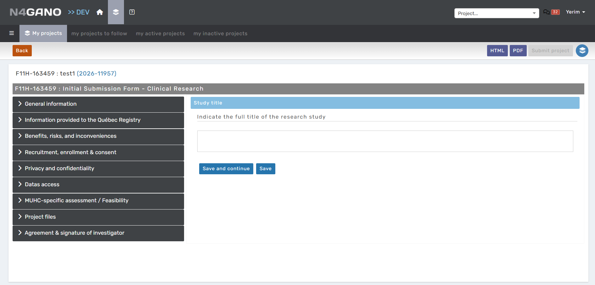
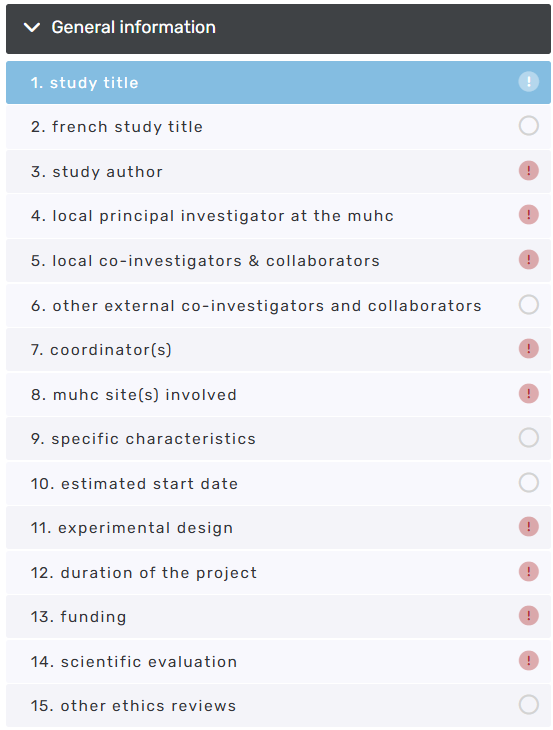

# F11 Part 1 — General Information

Once your project is created, Nagano generates the F11 — the main submission form you complete before your study can be reviewed.

## The F11 form

The F11 is organized into numbered sections covering everything reviewers need to assess your study: your team, study design, ethics considerations, privacy and data access, feasibility, supporting documents, and the PI's final commitment and signature.

The F11 supports two parallel processes running simultaneously: **scientific and ethics review** by the REB, and **feasibility review** confirming the study can be conducted at the MUHC with the right resources and approvals.

This user guide uses the **F11-H** (Clinical Research / Clinical Trial) as the primary example. If you selected a different project type, Nagano may have generated a different F11 variant — your sections and questions may differ, but the structure and logic are the same.

<Frame>
  
</Frame>

---

## Part 1: General Information

The first part of the F11 captures the foundational details of your study: titles, the study team, the MUHC site(s) involved, study design, and any specific characteristics that trigger additional review steps. Getting these right early shapes how the rest of the submission is interpreted by both feasibility and REB reviewers.

<Frame>
  
</Frame>

---

## Sections 1–2: Study titles

- **Section 1 — Study title** — Enter the full study title. Match the protocol title or the official working title your team uses consistently.
- **Section 2 — French study title** — Complete this if the study has an official French title or if your team uses one consistently.

---

## Section 3: Study author

This question asks who initiated or created the study protocol — not who is completing Nagano today. Choose the option that best reflects how the study was initiated.

---

## Section 4: Local PI

Identify the MUHC local PI responsible for the study.

- The study author and the local MUHC PI can be different people.
- Even for externally led studies, a local MUHC PI is required.
- Use the contact search. Create a new contact only if the person is not in the list.
- Select the PI's department when prompted.

<Warning>
The PI field carries compliance implications, so confirm the PI's eligibility before you proceed. Before acting as principal investigator at the MUHC, a person must hold Human Research Privileges, Researcher Status or a written institutional authorization. [Which credential the principal investigator needs](/training/compliance-requirements#know-which-credential-you-need) depends on whether the study is a Health Canada-regulated study with an investigational product and on whether the research requires medical oversight.

For a Health Canada-regulated study with an investigational product, or research that requires medical oversight, the principal investigator must hold valid Human Research Privileges and the institutional training for the study. Privileges are for physicians and dentists who are members in good standing of the MUHC's Council of Physicians, Dentists, Pharmacists and Midwives.

The RI-MUHC's standard operating procedures (SOPs) require Privileges of the principal investigator of any Health Canada-regulated study with an investigational product: a drug, a medical device or a natural health product.

In a drug or natural health product trial regulated by Health Canada, the qualified investigator must be a physician, unless the product is for dental use only. Through an interim policy, Health Canada also accepts a person who is not a physician or dentist as the qualified investigator of a drug trial if they meet [its conditions](/kb/governance/laws-regulations#know-what-health-canada-is-changing). The MUHC's requirements for the PI still apply to them.

If a study is not a Health Canada-regulated study with an investigational product and does not require medical oversight, the principal investigator must hold valid Human Research Privileges or Researcher Status. Researcher Status covers only research that does not require medical oversight. The MUHC requires pharmacists acting as principal investigator to obtain Researcher Status instead of Privileges.

Choosing the wrong PI early can require revising key fields or reworking parts of the submission later. See RI-MUHC [SOP-CR-500](/sops/cr-500), section 4.0 for full requirements.
</Warning>

<Note>
Nagano uses "PI" (principal investigator) throughout. In a drug or natural health product trial, Health Canada's regulations call the person responsible to the sponsor for the conduct of the trial at a site the [qualified investigator](/kb/foundations/glossary#qi). The Medical Devices Regulations define a device trial's qualified investigator differently. If the protocol author is not the PI, they can be listed as a co-investigator or collaborator.
</Note>

{/* Sources: b185 second reader (Nov. 18, 2026), for the qualified investigator's sentences only: the Food and Drug Regulations, C.05.001, and the Natural Health Products Regulations, section 63 (a physician, or a physician or dentist for a product "to be used for dental purposes only"); Health Canada's interim policy for the modernization of the clinical trial framework (Sept. 14, 2026; page modified Oct. 28, 2026), policy statement 2, through kb/governance/laws-regulations; roles/pi-guide ("The MUHC's requirement still applies to them."). The semicolon that joined the qualified investigator's rule to the PI's became two sentences (STYLE-HUB part C rule 4). The rest of the Warning is unchanged. b431 second reader (Nov. 23, 2026; reconciled with apps/nagano/guide-01, "PI eligibility by study type"): the first and third paragraphs now follow the topic's home, training/compliance-requirements, "Human Research Privileges and Researcher Status" and "Know which credential you need": SOP-CR-500_06, section 2.0 (Privileges "to be a QI/PI in order to conduct MUHC/RI-MUHC studies requiring medical oversight"; Researcher Status "to be a PI conducting a human research study that does not require medical oversight"), section 3.0 ("Obtaining the appropriate level of institutional training as per SOP-CR-003"; "valid RI-MUHC Human Research Privileges or Researcher Status (as applicable)") and section 4.0 ("Privileges are required for QI/PIs conducting Health Canada regulated studies with IP (drug, medical device or natural health product)."; "an individual granted Researcher Status cannot conduct research involving human medical oversight"); the Regulatory Framework, section 3.1.01A, through the home's Sources comments (the written institutional authorization; the council's name, the CPDPM; pharmacists' Researcher Status). Old text, for MF: "**PI eligibility — confirm before you proceed:** The PI field carries compliance implications. For interventional clinical studies requiring medical oversight, the PI must be a physician or dentist who is a member in good standing of the MUHC's Council of Physicians, Dentists and Pharmacists, with up-to-date research privileges and training." and "For non-interventional studies, the PI must have the appropriate RI-MUHC authorization (Researcher Status or privileges, as applicable)." The sources' test is medical oversight, not whether a study is interventional; the council's name is the CPDPM (the MUHC's Règlement intérieur, HPO 070, section 6.13.4, through the home). Kept, unverified: "in good standing" (not in SOP-CR-500_06; the Framework's text was not found in tools/_sources_text/).  b435 second reader (Nov. 24, 2026; the blind fact check of the b431 drafts; reconciled with apps/nagano/guide-01, "PI eligibility by study type", and apps/nagano/guide-04, "Categories and PI eligibility"): the test is not medical oversight alone. SOP-CR-500_06, section 4.0, its Note ("Privileges are required for QI/PIs conducting Health Canada regulated studies with IP (drug, medical device or natural health product)."), and the home's table (training/compliance-requirements, "Know which credential you need": Privileges cover "Research that requires medical oversight, and research that does not", with the example "Any Health Canada-regulated study with an investigational product (a drug or biologic, a medical device or a natural health product), which requires Privileges."). The b431 Warning said the credential "depends on whether the research requires medical oversight" and "For research that does not require medical oversight, the principal investigator must hold valid Human Research Privileges or Researcher Status.", which read as allowing a holder of Researcher Status to lead a Health Canada-regulated device study with no medical oversight; the first, second and fourth paragraphs now name both tests, and the second and fourth are each split in two at a sentence break (hubcheck para-length; no word changed). The Note (moved above this comment, with no change to what the reader sees, so that the comment closes the section): the corrected Note of apps/nagano/guide-01, word for word, without its bold label (STYLE-HUB H: no bold label inside a box), with this page's last sentence kept word for word (the protocol author, an open question for its owner). It said that "for interventional clinical studies the PI is effectively acting in the role of Qualified Investigator (QI) — the legally defined term in Canada for the person responsible for conduct of a clinical trial at a site, who is entitled to provide health care under provincial law": qualified investigator is the regulations' term for drug, natural health product and device trials only (STYLE-HUB D), defined differently for devices (the Medical Devices Regulations, section 1: "qualified investigator means a person who is a member in good standing of a professional association of persons entitled under the laws of a province to provide health care in the province and who is designated, by the ethics committee of the health care facility at which investigational testing is to be conducted, as the person to conduct the testing."), and "interventional" is not the test for who may be principal investigator. The Note's sources, through kb/foundations/glossary, "Principal Investigator (PI)" and "Qualified Investigator (QI)": the Food and Drug Regulations, C.05.001; the Natural Health Products Regulations, section 63; the Medical Devices Regulations, section 1. */}

---

## Sections 5–7: Co-investigators, collaborators, and coordinators

### Section 5 — Local co-investigators and collaborators

Add MUHC/RI-MUHC collaborators formally involved in the study.

<Warning>
**Co-investigators vs. collaborators in Nagano:** These are different categories. **Co-investigators** are the study's [sub-investigators](/kb/foundations/glossary#sub-investigator), qualified members of the study team whom the PI designates and supervises to perform critical investigator tasks as described on the Task Delegation Log. Each one must be trained for their tasks, with the training documented, before they sign the Task Delegation Log. **Collaborators** have a different role and should not be listed in the co-investigator section.

For recognition purposes, collaborators such as PhD students can be added in a separate section, but this does not affect the regulatory aspects of the submission.
</Warning>

{/* Sources: b290 second reader (Nov. 19, 2026; MF, ledger row 330), for the co-investigators' two sentences only: the SOP Glossary of Terms, "Sub-Investigator (delegated on the Task Delegation Log)" ("A qualified member of the clinical trial team designated and supervised by the Qualified/Principal Investigator at a trial site to perform critical Investigator tasks as described on the Task Delegation Log and/or make important trial-related decisions."), through the glossary's "Sub-Investigator" and "Co-Investigator" entries; SOP-CR-002_09, section 5.6.3 ("All persons listed on the Task Delegation Log must have already been appropriately trained to conduct the task(s) they are delegated and this training must be documented prior to the individual and the investigator signing the Task Delegation Log."). Changed: co-investigators were "doctors who will actively participate in study procedures and see participants directly". A sub-investigator need not be a physician: the SOP Glossary's "qualified member"; SOP-CR-500_06, section 2.0 (non-MDs "(and their backup)" obtain Researcher Status to lead a study that does not require medical oversight) and section 1.0 ("Sub-Investigators delegated QI/PI backup tasks"). "See participants directly" has no source found and could keep off the list a sub-investigator delegated only, for example, SUSAR review (SOP-CR-002_09, section 5.3.6): taken out, listed for MF, and asked of the Centre for Applied Ethics with Nagano's own meaning of "co-investigator". The co-investigator pop-up: the glossary's entry. */}

### Section 6 — External co-investigators and collaborators

Capture collaborators outside the MUHC. This is especially important for multi-site studies or those involving external networks.

### Section 7 — Coordinators

Add local study coordinator(s). If one person will be the primary point of contact with reviewers, make sure they are clearly identified here.

---

## Section 8: MUHC site(s)

Select the MUHC site(s) where study activities will take place — recruitment, visits, procedures, and data collection. Choose based on where work will actually happen.

---

## Section 9: Specific characteristics

Select only the characteristics that truly apply to your study. Each selection may trigger additional required fields, forms, or review steps — so accuracy here matters. If a characteristic does not apply, leave it unchecked.

<AccordionGroup>
  <Accordion title="Research using an existing bank">
    Collections of biospecimens or data are considered a "bank" if they are collected, stored, and distributed for use in future research (MSSS, 2012). Select this only if you are **accessing** an already-established bank — not creating a new one.

    Nagano will ask you to indicate whether the bank is located within the institution (MUHC, RI-MUHC, Neuro) or outside it, provide the name of the bank and the contact information of the person responsible, and attach a copy of the management framework, consent form, and consent for biobank in the Project Files section.

    <Note>
      Contact the Contracts Review Office to confirm whether a Material Transfer Agreement (MTA) is required for the transfer of materials or data from the bank.
    </Note>
  </Accordion>
  <Accordion title="Research involving creation of a bank">
    Select this if creating a new bank — collecting, storing, and distributing biospecimens or data for future research — is part of this project (MSSS, 2012).

    Nagano will ask you to indicate whether the bank will be located within or outside the institution, provide the name of the new bank, and clarify how biospecimens will be procured.

    <Warning>
      **Separate F11-BR submission required:** If your study also involves the creation of a bio- or databank, you must submit the bank as its own project using form **F11-BR**. Contact the REB if you have questions about whether this applies to your study.
    </Warning>
  </Accordion>
  <Accordion title="Access to information">
    Select this for studies based solely on access to participant files or existing clinical/administrative/research data — with no direct participant contact for data collection.

    <Note>
      Selecting this triggers a message prompting you to complete the **"Access to information"** section of the F11. That section is covered later in this user guide (Section 8: Data Access). You do not need to resolve it here — just note that it will appear.
    </Note>
  </Accordion>
  <Accordion title="Genetic or genomic component">
    Select this if your study involves collection, analysis, or use of genetic or genomic data. This may trigger additional ethics review considerations related to privacy, consent, and incidental findings.
  </Accordion>
  <Accordion title="Neuroimaging component">
    Select this if your study uses neuroimaging. MNI resources (PET, MRI, MEG) require separate approval letters from the relevant MNI review committees — these are uploaded in the Feasibility section (Section 9 of this user guide).
  </Accordion>
  <Accordion title="Artificial intelligence methods">
    Select this for projects that involve the development of artificial intelligence technologies using previously collected health data. Nagano will prompt you to download and complete the corresponding AI protocol template before proceeding.
  </Accordion>
  <Accordion title="Assisted reproduction methods">
    Select this if your study involves assisted reproduction methods. This triggers additional review considerations specific to this research context.
  </Accordion>
  <Accordion title="Adaptive design trial">
    Select this if your clinical trial uses a pre-specified adaptive design — where interim data may be used to modify the trial while it is ongoing, without undermining its validity or integrity.
  </Accordion>
  <Accordion title="University or graduate students">
    Select this if the research involves university or graduate students. Nagano will ask you to indicate the students' level of education: Master's, Doctorate, Post-doctoral, Medical resident, or Other.
  </Accordion>
</AccordionGroup>

---

## Sections 10–15: Dates, design, funding, and reviews

### Section 10 — Estimated start date

Enter a realistic date after anticipated approvals — not the date you begin preparing documents.

### Section 11 — Experimental design

Indicate applicable design features: randomization, blinding, placebo. If a feature does not apply, select "not applicable."

### Section 12 — Duration

Expected study duration in months, from authorization through closure.

### Section 13 — Funding

Select all funding sources that apply. If there is no funding, indicate that clearly.

### Section 14 — Scientific evaluation

Answer based on whether scientific evaluation is required at the reviewing institution.

### Section 15 — Other ethics reviews

Indicate whether another REB has reviewed the project. If yes, attach approval documentation in the document upload section.

---

## Before you move on

These details shape how the rest of the submission is interpreted by both feasibility and REB reviewers. Confirm the following before proceeding to the next section of the F11.

- ✓ The correct MUHC local PI is identified and their eligibility has been confirmed.
- ✓ The right MUHC site(s) are selected — reflecting where study activities will actually take place.
- ✓ Only the specific characteristics that truly apply are checked in Section 9.
- ✓ Study title matches the protocol title or the official working title used by your team.
- ✓ All team members (co-investigators, collaborators, coordinators) are added in the correct sections.
