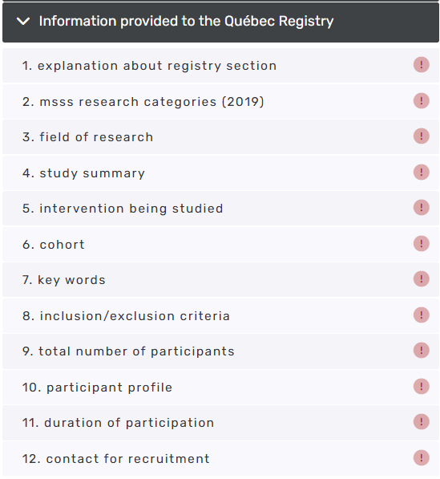

# F11 Part 2 — Québec Registry

Covers the Québec Clinical Trial Registry fields in the F11-H — the public-facing information that makes your study findable and supports participant recruitment.

## Part 2: Québec Registry

This part of the F11-H populates the Québec Clinical Trial Registry. The information you enter here is public-facing — reviewers are looking for clear, plain-language descriptions that accurately represent the study and would make sense to a potential participant. This section applies to F11-H forms only; if your form does not include it, that is expected.

<Frame>
  
</Frame>

---

## Section 2 — MSSS research categories (2019)

Select the category or categories that best describe your study. This question appears in all Nagano submission forms and is used by the institution and Quebec's health ministry for analysis and statistical purposes.

### Categories and PI eligibility

The category you select also has implications for who can serve as PI.

<AccordionGroup>
  <Accordion title="Health Canada-regulated: Human Research Privileges for a study with an investigational product">
    The RI-MUHC's standard operating procedures (SOPs) require [Human Research Privileges](/training/compliance-requirements#know-which-credential-you-need) of the principal investigator of any Health Canada-regulated study with an investigational product: a drug, a medical device or a natural health product. Privileges are for physicians and dentists who are members in good standing of the MUHC's Council of Physicians, Dentists, Pharmacists and Midwives. The principal investigator's Privileges must be valid.

    Categories in this branch:
    - **Experimental drug** — select the trial phase (I, II, I/II, III, II/III, IV)
    - **Cell therapy** — indicate whether Health Canada authorization (NOL) has been obtained, is pending, or is not required
    - **Medical device** — select the device class (I, II, III, IV)
    - **Software** — select the software class (I, II, III, IV)
    - **Radiopharmaceutical product** — indicate NOL status
    - **Natural health product** — indicate NOL status

    <Note>
      Reference: RI-MUHC [SOP-CR-500](/sops/cr-500), section 4.0, or contact the Research Facilitator.
    </Note>
  </Accordion>
  <Accordion title="Not Health Canada-regulated: Human Research Privileges or Researcher Status">
    The principal investigator must hold the credential the research needs: [Human Research Privileges or Researcher Status](/training/compliance-requirements#know-which-credential-you-need). Privileges are for physicians and dentists who are members of the MUHC's Council of Physicians, Dentists, Pharmacists and Midwives. Researcher Status is for other researchers, and for pharmacists acting as principal investigator. Researcher Status covers only research that does not require medical oversight.

    Categories in this branch:
    - **Quasi-experimental research** — cohort study, case-control study, cross-sectional study, or population survey
    - **Descriptive research**
    - **Qualitative research**
    - **Mixed design** (quantitative/qualitative)
    - **Creation of a databank or biological material** — where this is the primary objective
    - **Basic research**
    - **Observational research**
    - **Translational research**

    <Note>
      Reference: RI-MUHC [SOP-CR-500](/sops/cr-500), section 4.0.
    </Note>
  </Accordion>
</AccordionGroup>

{/* Sources: through training/compliance-requirements, "Know which credential you need", the topic's home, in its words: SOP-CR-500_06, section 2.0 (Privileges "to be a QI/PI in order to conduct MUHC/RI-MUHC studies requiring medical oversight"; Researcher Status "to be a PI conducting a human research study that does not require medical oversight", for non-MDs including pharmacists), section 3.0 ("Each Qualified/Principal Investigator, or Sponsor-Investigator has valid RI-MUHC Human Research Privileges or Researcher Status (as applicable)") and section 4.0 ("Privileges are required for QI/PIs conducting Health Canada regulated studies with IP (drug, medical device or natural health product)."; "an individual granted Researcher Status cannot conduct research involving human medical oversight"); the Regulatory Framework, section 3.1.01A (Privileges "are required for physicians and dentists who are members of the" CPDPM; "Pharmacists acting as principal investigators conducting research activities involving human participants must obtain researcher status."). b431 second reader (Nov. 23, 2026): the first title said "PI must be a physician with Research Privileges" and its text "a physician with CPDP membership in good standing and up-to-date Research Privileges"; Privileges also go to dentists, and the SOPs' rule is for a Health Canada-regulated study with an investigational product. The second said "Privileges for physicians and dentists; Researcher Status for other researcher profiles", which left out that Researcher Status covers only research without medical oversight. Kept, unverified: "in good standing" (no source found in SOP-CR-500_06). "Up-to-date" is now SOP-CR-500_06's "valid". */}

---

## Sections 3–5 — Field, summary, and intervention

<AccordionGroup>
  <Accordion title="Section 3 — Field of research">
    Choose the predominant field — the main lens of the study. Use **Other** if nothing fits.
  </Accordion>
  <Accordion title="Section 4 — Study summary (public-facing)">
    Write as if explaining to a potential participant. Use plain language — no protocol jargon or internal references. Structure your summary around:
    - The hypothesis or research question
    - The study objectives
    - The methodology
    - Any additional context a reader would need to understand the study
  </Accordion>
  <Accordion title="Section 5 — Intervention (if applicable)">
    List the drug, molecule, product, or instrument being studied. Include:
    - Trade name
    - Generic name
    - Any common nomenclature
  </Accordion>
</AccordionGroup>

---

## Sections 6–8 — Cohort, keywords, and criteria

<AccordionGroup>
  <Accordion title="Section 6 — Cohort (if applicable)">
    Only use this if recruitment is organized into distinct cohorts. If recruitment is essentially one population, you usually do not need to create cohorts.
  </Accordion>
  <Accordion title="Section 7 — Key words">
    Choose terms a potential participant might actually search. Keep them specific, comma-separated, and in everyday language.
  </Accordion>
  <Accordion title="Section 8 — Inclusion / exclusion criteria">
    Write at a high level, in recruitment-friendly language. Help someone quickly understand _"Who might qualify?"_ — do not reproduce your full protocol eligibility criteria here.
  </Accordion>
</AccordionGroup>

---

## Sections 9–12 — Participants, duration, and contact

<AccordionGroup>
  <Accordion title="Section 9 — Total participants">
    Enter totals for the entire study, for Québec (if known), and for your institution. If numbers are not yet defined, enter **0** and add a brief explanation.
  </Accordion>
  <Accordion title="Section 10 — Participant profile">
    Select all options that apply — age group, capacity, characteristics.

    <Warning>
      **RAMQ coverage:** Declare _"not covered by RAMQ"_ only when a specific participant has been identified as not covered. This triggers an institutional process — do not select it speculatively.
    </Warning>
  </Accordion>
  <Accordion title="Section 11 — Duration of participation">
    Enter the time from consent signing through the end of a participant's involvement — not the total study duration.
  </Accordion>
  <Accordion title="Section 12 — Contact for recruitment (public)">
    This contact information will be visible to the public on the registry. Use a monitored study email address or clinic phone line — not a personal number. Ensure someone is responsible for responding promptly to any inquiries.
  </Accordion>
</AccordionGroup>

---

## Before you move on

Confirm the following before leaving the Québec Registry section.

- ✓ The correct Health Canada regulation status is selected in Section 2.
- ✓ The study summary is written in plain language, suitable for a potential participant to read.
- ✓ Inclusion/exclusion criteria are written at a high level — not a reproduction of full protocol criteria.
- ✓ Participant numbers are entered, or a note explains why they are not yet available.
- ✓ The recruitment contact is a monitored address or line, not a personal number.
