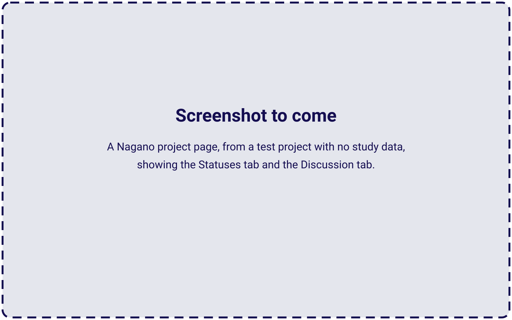
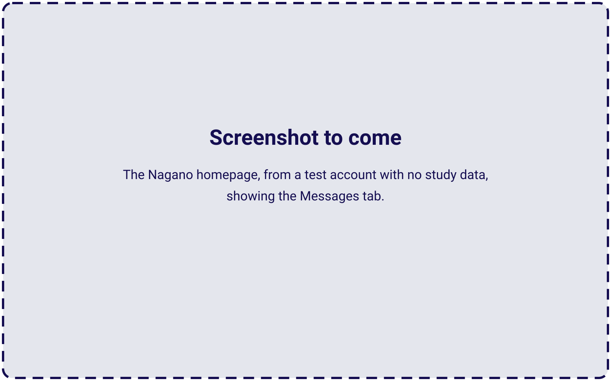

# Tracking Your Project in Nagano

Once you submit your project in Nagano, review and decision-making happens on the platform. This section covers how to find your project, read the Status screen, understand status labels, and respond when action is required.

## Returning to your project after submission

After submitting, access your project through **My Projects**. As reviews progress and decisions are recorded, the project workspace will populate with more information.

<Steps>
  <Step title="Go to My Projects">
    Select **My Projects** from the Nagano navigation.
  </Step>
  <Step title="Open your project">
    Click the **project title** or **project number** to open the project workspace.
  </Step>
</Steps>

---

## The Status tab — your primary progress tracker

The **Status tab** gives the fastest, most reliable overview of where your submission stands. Check it each time you sign in — especially after submitting something or expecting a review update.

The Status tab shows:

- Whether your study is still in progress or moving toward authorization
- Which review elements are completed and which are pending
- Whether something is waiting on a response or update from your team

<Frame caption="Screenshot to come.">
  
</Frame>

{/* TO CONFIRM (MF): replace with a screenshot from a test project with no study data, showing the project page's Statuses (or "Status") tab and its Discussion tab. The screenshot also settles the tab's name: "Status" on this page, "Statuses" on kb/submission/tracking-responding (Community Connect #2's screenshots, FACTS). MF, Nov. 14, 2026: "put placeholder screenshots and i'll source them later". Master doc, Decisions for MF. */}

<Note>
Make checking Status a habit when you sign in — it is where you see what is currently pending and what is required next.
</Note>

---

## Reading the Status screen

Status typically displays a table with a review or evaluation element on the left and its current status on the right. Depending on your study, this may include:

- **Project-level authorization status** — whether the study is authorized for research
- **Reviewing REB status** — the current state of the ethics review
- **Feasibility elements** — services, resources, and readiness checks, each with its own status
- **Timestamps** — when authorization or decisions were recorded

---

## Two kinds of status labels

Not all status labels mean the same thing. Nagano uses two distinct types — REB review decisions and form workflow statuses. Knowing which type you are looking at helps you determine whether action is needed.

<AccordionGroup>
  <Accordion title="Type 1 — REB review decisions: what the REB decided about your study">
    These labels reflect the formal decision of the reviewing ethics board. They appear once a review cycle is complete.

    - **Approved.** The study is approved as submitted; REB approval lasts up to a year.
    - **Approved with modifications.** The REB requires changes or information before its final approval. Its letter is a conditional approval letter, and its conditions come in an F20 form.
    - **Deferred.** The REB needs major changes or more information, and reviews the study again once you resubmit.
    - **Disapproved.** The study cannot go ahead as proposed.

    Researchers have the right to request reconsideration or appeal. See REB-SOP 401 for the process.
  </Accordion>
  <Accordion title="Type 2 — Form workflow statuses: what is happening to the form in Nagano right now">
    These labels reflect the current state of a form in the Nagano workflow. Use them to answer: _"Can we do something right now, or are we waiting?"_

    - **Created.** The form hasn't been submitted, and review can't start until it is. Action is required.
    - **Re-opened.** The REB has re-opened the form with comments that need your team's attention. Action is required.
    - **Submitted.** The form is submitted. No action is required.
    - **Ready.** The form has been assigned for review. For the F11, it changes to Approved once the study has MUHC Authorization.
    - **Approved.** For the F11, the study has MUHC Authorization. Begin only once every [start condition](/kb/submission/submission-overview#before-recruitment-and-keeping-approval-valid) is met.

    On the F20, the REB's conditions form, the status Pre-approved is for the REB's internal use. On forms for an approved study, such as an amendment, the REB records its decision in the form itself, and it can differ from the form's status.
  </Accordion>
</AccordionGroup>

---

## Responding when follow-up is needed

When the REB needs something from your team, it re-opens the form, or sends its conditions in an F20 form; feasibility reviewers may write through the Messages tab.

### If the form shows Re-opened

<Steps>
  <Step title="Review the comments">
    Review the comments or conditions in the form.
  </Step>
  <Step title="Update the form and documents">
    Update the form and/or upload revised documents as required.
  </Step>
  <Step title="Re-submit">
    Re-submit the form once all responses are complete.
  </Step>
</Steps>

### If you see a decision but the form is not yet re-opened

- You cannot enter your response until the REB re-opens the form.
- Contact the REB to request that the form be re-opened.

<Warning>
**Important:** Do not wait for something to happen on its own. If you are expecting to respond and the form is not re-opened, reaching out to the REB is the appropriate unblocking step — the process will not advance without it.
</Warning>

---

## The Messages tab — feasibility follow-ups

While Status shows overall progress, the **Messages tab** is where feasibility reviewers, such as the pharmacy and the Research Agreements Office, may send follow-up requests and clarifications. The REB writes in the project's **Discussion** tab, which feasibility reviewers don't see. Check Messages when:

- Status shows something pending and you are not sure why
- You are expecting a request for clarification or missing documentation
- Your project has feasibility items that depend on confirmations such as training or privileges

<Frame caption="Screenshot to come.">
  
</Frame>

{/* TO CONFIRM (MF): replace with a screenshot of the Nagano homepage from a test account with no study data, showing the Messages tab. MF, Nov. 14, 2026. Master doc, Decisions for MF. */}

A simple routine that works:

1. Open the project from **My Projects**.
2. Check **Status** — what is complete vs. pending.
3. Check **Messages** — any follow-ups on pending items.
4. Respond to a feasibility reviewer through Messages, and to the REB in the Discussion tab or in the form once it is re-opened.

---

## Activities tab and email notifications

Two additional tools help you stay aware of project activity between sign-ins.

- **Activities tab.** A chronological timeline of project updates, such as new messages, evaluation changes and status changes. Useful when you manage multiple projects or want to see what has changed since you last checked.
- **Email notifications.** Nagano emails you only about the activities you select. Open the menu under your name (top right), choose **Select the activities**, and tick the email box for each kind of activity you want.

<Warning>
**Important:** Even with email notifications enabled, always confirm progress directly in Nagano. Email is a convenience — Status is where you see what is currently pending and what is required next.
</Warning>

---

## Key reminders

After submitting your project, keep these practices in place.

- ✓ Return to your project via My Projects — click the title or project number to enter the workspace.
- ✓ Check the Status tab each time you sign in — it is your primary tracker for what is pending and what is required.
- ✓ Distinguish REB decisions (what the REB decided) from form workflow statuses (what is happening in Nagano right now).
- ✓ When a form is re-opened, review the comments, update and/or upload as needed, then re-submit.
- ✓ If you see a decision but the form is not yet re-opened, contact the REB to request access — do not wait.
- ✓ Check Messages for follow-ups when something is pending and the reason is unclear.
- ✓ Choose your email notifications under Select the activities, and still confirm status in Nagano directly.
