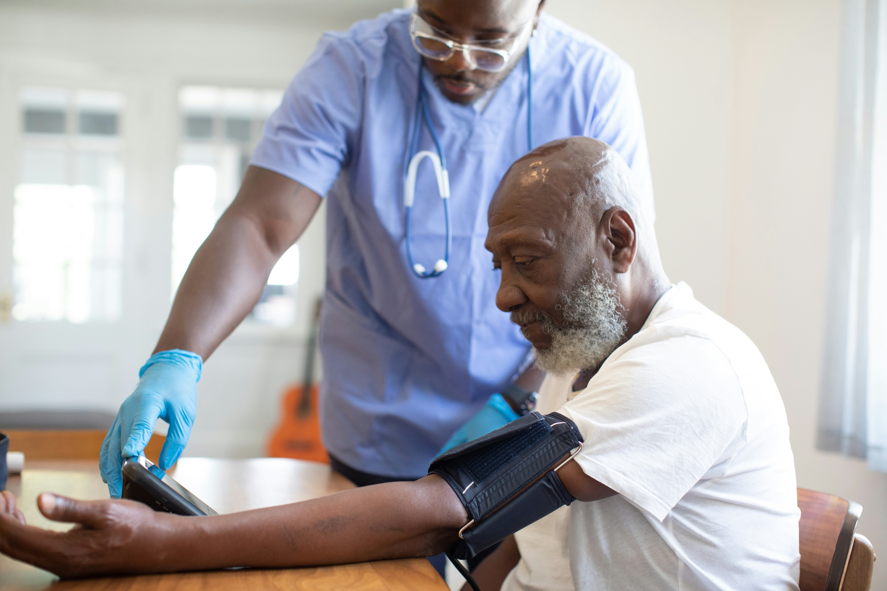

A research nurse is a nurse licensed by the Ordre des infirmières et infirmiers du Québec (OIIQ) who works on research studies at the MUHC, at the Centre for Innovative Medicine (CIM) or on a study team. The <Tooltip tip="The investigator who leads the study team at a site and is responsible for conducting the study there." headline="Principal Investigator (PI)" cta="Full definition" href="/kb/foundations/glossary#pi">principal investigator</Tooltip> delegates each research nurse's study tasks on the study's <Tooltip tip="The investigator's list of the appropriately qualified people to whom the investigator has delegated significant study-related tasks." headline="Task Delegation Log (TDL)" cta="Full definition" href="/kb/foundations/glossary#tdl">Task Delegation Log</Tooltip>. When the tasks go to a nurse manager whose staff work on rotation, [the staff need not be listed on the log one by one](/sops/cr-002#5-7-1), provided that evidence of their qualification is available.

Research nurses work in two ways. Some also coordinate the study as its <Tooltip tip="A nurse, health professional or other qualified member of the research team who handles most of the administrative responsibilities and day-to-day activities of a clinical trial." headline="Clinical Research Coordinator (CRC)" cta="Full definition" href="/kb/foundations/glossary#crc">clinical research coordinator</Tooltip> (CRC), and are called CRC-Nurses. The Glossary of Terms of the RI-MUHC's standard operating procedures (SOPs) lists research nurse and protocol nurse among the coordinator's other names.

Other research nurses perform delegated clinical tasks, such as giving the investigational product, infusions, specimen collection and study assessments, while a separate coordinator coordinates the study. Nurses work this way in outpatient research clinics, in ward-based inpatient studies, at participants' homes in decentralized studies, and at the CIM.

Your OIIQ licence and the RI-MUHC's institutional training are separate requirements, and neither replaces the other. The licence decides which clinical acts you may perform. The study's delegation and training decide which of them you perform on the study.

If you also coordinate the study, the [Coordinator](/roles/coordinator) page applies to your coordination tasks as well. A research nurse who also coordinates has one entry on the Task Delegation Log, covering both kinds of task.

{/* Sources: the RI-MUHC's SOP Glossary of Terms (Apr. 27, 2023), "Clinical Research Coordinator (CRC)", through kb/foundations/glossary, "Clinical Research Coordinator (CRC)" ("A nurse, health professional or other qualified member of the research team who handles most of the administrative responsibilities and day-to-day activities of a clinical trial."; "Other names include trial coordinator, study coordinator, research coordinator, clinical coordinator, research nurse and protocol nurse."); kb/team/building-your-team, "Fill the core roles" (the role "Clinical research coordinator or research nurse"); SOP-CR-002_09, section 5.6.1 ("The Investigator must maintain a list of appropriately qualified persons to whom he/she has delegated significant study-related tasks."); training/compliance-requirements, "Who needs training" ("Research coordinators and research nurses."; "Training is required of every team member, regardless of their eligibility for Privileges or Researcher Status."). The two ways of working, the settings, the separateness of licence and training, and the single log entry: from the live page, kept with no source found (b302 record, for QA). The TDL, PI and CRC pop-ups: the glossary's entries, as on roles/investigator and kb/team/building-your-team. b307 (second reader; b304 T2, C): "Each research nurse appears on the study's Task Delegation Log" became the principal investigator's delegation on the log, with SOP-CR-002_09, section 5.7.1 ("When study protocol task(s) are delegated to a person in charge of other staff on rotation (for example, a nurse manager, imaging manager, manager of medical technologists drawing blood etc.) further sub delegation to individual staff does not need to be documented on the Tasks Delegation Log, provided that evidence of qualification of those individuals is available."). */}

## Follow the steps for your type of study

The steps of a study, in the order they happen, are on the page for its type. [Types of Study](/paths) helps you find which type a study is.

- [Drug studies (Level I)](/paths/level-i)
- [Medical device and surgery studies (Level II)](/paths/level-ii)
- [Natural health product studies (Level III)](/paths/level-iii)
- [Prospective studies not regulated by Health Canada (Level IV)](/paths/level-iv)
- [Retrospective and biobank studies (Level V)](/paths/retrospective)

If you aren't sure where a study fits, the [Research Facilitator](mailto:research.facilitator@muhc.mcgill.ca) can help you place it and find the steps you need.

{/* Sources: paths/index, "Find the training level your study needs" and "Follow the steps for your type of study" (the five paths and their titles; the tags' wordings, STYLE-HUB F1), as on roles/investigator; the Research Facilitator's role as on paths/index's Contacts ("Which kind of study yours is and which training level it needs, RI-MUHC processes and SOPs."). */}

## Know what you may do once a task is delegated to you

A research nurse performs only the study tasks delegated on the Task Delegation Log, and only those the nurse is qualified and trained to do. [The principal investigator keeps oversight of every person given a task](/roles/investigator#know-what-you-are-responsible-for-as-principal-investigator), and keeps the responsibilities the tables below name. Your licence still governs every clinical act, as [Stay within your licence](#stay-within-your-licence) explains.

The clinical assessment tasks on [the Task Delegation Log](/sops/cr-002#appendix-1) are collecting biological specimens, taking vital signs, performing electrocardiograms (ECG) and administering the study drug.

{/* Sources: SOP-CR-002_09, section 5.6.1 ("The Investigator must maintain a list of appropriately qualified persons to whom he/she has delegated significant study-related tasks.") and section 5.3.5 ("The Investigator maintains oversight and responsibility for supervising any individual or party to whom tasks are delegated at the trial site."), through roles/investigator, "Know what you are responsible for as principal investigator"; SOP-CR-002_09, Appendix 1, the Task Delegation Log template (_review/2026-11/tools/_sources_text/Reference files__CLEAN_SOP-CR-002_09 Appendix 1 Task Delegation Log-VK-16Jan23-Clean.docx.txt), under "CLINICAL ASSESSMENTS": "200 Collect biological specimen s", "201 Perform vital signs", "202 Perform ECG", "203 Drug administration". The paragraph names the log's own category, "CLINICAL ASSESSMENTS", and its four tasks; WI-CIM-GN005_01, section 5.2.1, gives the CIM's general nursing tasks the same way ("general nursing tasks on a study (e.g., blood draw, taking vitals, ECG)"). */}

### Before you take on study tasks

| Task | What you may do once it is delegated | What stays with the principal investigator |
|---|---|---|
| Training | Have your training for each task documented before you and the principal investigator sign the log. Each team member should hold the study's [level of institutional training](/training/compliance-requirements#training-requirements-by-study-level), or a higher one, before signing. Training on the protocol must be documented before tasks are delegated, and it may take place at the [site initiation visit](/kb/site-activation/site-setup#take-part-in-the-site-initiation-visit). Keep your training up to date by [renewing each certificate](/training/compliance-requirements#renew-your-certificate) before it expires. When you return from a [leave of absence of more than six months](/kb/conduct/study-operations/team-management#leave-of-absence), redo your institutional training at the level of the studies you will then work on. | The principal investigator [must ensure](/roles/investigator#before-you-submit-the-study) that each team member holds the study's level of institutional training, documented, before tasks are delegated to them. |
| The Task Delegation Log | Sign and date the Task Delegation Log to accept the tasks delegated to you. The log names each specific task delegated to you, with its start and end dates. A generic entry such as "clinical tasks" is not enough. | Only the principal investigator signs to confirm that you are qualified and trained for the tasks delegated. |
| Licence and records | File a current copy of your licence in your employment record. Your manager or People and Culture maintains it. If you also coordinate the study, [file your documented training and your CV with the essential documents](/sops/cr-002#5-4-1). | The principal investigator must ensure that the team's documented training, current CVs and licences are on file and available for audit and inspection. When nursing is delegated as a team on rotation, the [nursing manager is added to the log](/kb/team/building-your-team#fill-the-core-roles) and keeps the staff's CVs and licences in the department's files. |

{/* Sources: SOP-CR-002_09, section 5.6.3 ("All persons listed on the Task Delegation Log must have already been appropriately trained to conduct the task(s) they are delegated and this training must be documented prior to the individual and the investigator signing the Task Delegation Log."), section 5.3.4 ("The Investigator must ensure that human research team members have also obtained the same level of institutional training deemed appropriate for the study being conducted"), section 5.1.2 ("the study team members must sign and date the Task Delegation Log in order to accept delegation of protocol tasks on the Task Delegation Log. The Investigator must sign the Task Delegation Log to confirm that each staff member is qualified and trained to conduct the study-specific task(s) that the Investigator is delegating."), section 5.3.5 ("Ensure that research team members have documented training and current CVs and licenses are on file and available for audit and inspection.") and section 5.7.1 (the Manager/Supervisor of a team on rotation signs Appendix 2, signs the log and has "staff CVs and licenses in her/his clinic/HR files"), through kb/team/building-your-team, "Fill the core roles", and kb/conduct/study-operations/team-management, "Add a new team member"; QA's draft SOP-CR-003_11 (a draft: its cover's effective date is "XX-XXX-2027"), the paragraph after section 5.2.4 (all team members "should obtain the same institutional training level (or better i.e., highest risk) prior to signing the study Task Delegation Log"), through training/compliance-requirements, "Training requirements by study level"; SOP-CR-003_10, section 5.3 ("This may occur at the SIV meeting and must occur prior to staff delegating tasks on the study Task Delegation Log."; FACTS "Batch 56", "Protocol training before delegation"); roles/investigator, "Before you submit the study" ("Only the principal investigator signs to confirm the delegation."). The specific tasks: SOP-CR-002_09, Appendix 1 (a template "to be adapted, initialed and dated prior to use (only keeping tasks that are part of study protocol)"). Kept from the live page with no source found (b302 record): "A generic entry such as 'clinical tasks' is not enough" (for QA) and the licence filed in the employment record by the manager or People and Culture (for People and Culture). b307 (second reader; b304 list 1, items 9 and 11, P27): QA's draft SOP-CR-003_11, section 3.0 ("It is the responsibility of all team members to ensure that their training remains up-to-date (renewed every 2 years).") and section 5.8.1 ("In the event of a leave-of-absence exceeding 6 months, human research team members will be required to redo their institutional training at the appropriate training level based on studies to be conducted upon their return."), through their homes, training/compliance-requirements, "Renew your certificate", and kb/conduct/study-operations/team-management, "Leave of absence" (the renewal period stays there, STYLE-HUB B3; b311, from the b310 check's A finding 1: "you may be required to redo your institutional training, depending on its length" became section 5.8.1's "will be required" after a leave "exceeding 6 months", as an instruction, in the words of roles/trainee, "Before tasks are delegated to you", and kb/conduct/study-operations/team-management, "Leave of absence"; the six months travel with the restated rule, B3, as on those pages; QA's draft read in its accepted text, batches/b276-gcp-level-ii/SOP-CR-003_11-accepted-text.txt, since the Word file's "SOP" before "training" in 5.8.1 is a tracked deletion); SOP-CR-002_09, section 5.4.1, in the section on the coordinator's roles ("The CRC assesses the skills required and prior to task delegation, obtains the necessary initial and ongoing institutional training, general training, training for each protocol and delegated tasks, filing his/her documented training and CV with essential documents."), so given for a research nurse who also coordinates. */}

### During the study

| Task | What you may do once it is delegated | What stays with the principal investigator |
|---|---|---|
| Consent | [Obtain participants' consent](/kb/recruitment/consent#choose-who-obtains-consent), if you are qualified, trained on the consent SOPs and the protocol, and delegated the task on the log. A research nurse should not obtain consent from a participant with whom they have a long-standing relationship. | The principal investigator must ensure that each participant's consent is obtained and documented as the RI-MUHC's SOPs require. |

Record what you do and observe in the source documents, as [Data Integrity](/kb/conduct/data-documentation/data-integrity#record-and-correct-data-properly) describes. Record each entry at the time of the activity, in permanent black or blue ink.

Correct an entry with a single line through it, so that the original stays readable, then initial and date the correction and explain it unless the reason is obvious. Notes of calls with participants, vital signs and observations of adverse events are source data too. On a portable device or a worksheet, [identify participants by their study number](/kb/governance/privacy#keep-participant-information-confidential), not by their name or medical record number (MRN).

{/* Sources: SOP-CR-008_08, section 5.1.2 ("Ensure that the person obtaining informed consent is qualified by education, experience and documented training to do so (i.e., trained on SOP-CR-006 and this SOP), has trained on the protocol and this training is documented, is knowledgeable in the study procedures and has subsequently been delegated this task by the QI/PI") and section 5.1.1 ("This person should not be the participant’s treating physician or other person with a long-standing relationship with the participant"), through kb/recruitment/consent, "Choose who obtains consent"; SOP-CR-002_09, section 5.3.6 ("Informed Consent has been obtained from each participant as per SOP-CR-008 and that the Informed Consent Process is documented") through roles/investigator, "During the study"; SOP-CR-014_08, section 5.6, through kb/conduct/data-documentation/data-integrity, "Follow ALCOA+" ("Use permanent black or blue ink") and "Record and correct data properly" ("Correct an entry by drawing a single line through it, so that the original stays readable. Initial and date the correction, and explain it unless the reason is obvious."); SOP-CR-014, section 5.7.4, through kb/governance/privacy, "Keep participant information confidential" ("Identify participants by their study number"). Changed: the live page's consent restriction ("if you have an established treating relationship with a participant") became SOP-CR-008_08 section 5.1.1's own scope for a person other than the treating physician, a long-standing relationship (b302 record). Kept from the live page with no source found: "at the time of the activity" and that call notes are source data (for QA). */}

#### Work with participants at study visits

Applies toDrug studies (Level I)Medical device and surgery studies (Level II)Natural health product studies (Level III)Prospective studies not regulated by Health Canada (Level IV)

| Task | What you may do once it is delegated | What stays with the principal investigator or a physician |
|---|---|---|
| Eligibility | Collect eligibility information. | The principal investigator must ensure that [each participant meets every eligibility criterion](/roles/investigator#check-eligibility-and-assess-adverse-events). The final medical decision on eligibility is the principal investigator's responsibility. |
| Clinical tasks | Perform the clinical tasks your licence allows as the protocol requires, such as [collecting specimens](/kb/conduct/study-operations/biological-specimens#collect-and-process-specimens), taking vital signs and performing ECGs. Assess the physical and mental condition of a participant who has symptoms. | Medical care and medical decisions in the study are under the principal investigator's supervision. Medical decisions can be delegated to a qualified and trained sub-investigator, once the delegation is documented on the log. Quebec's Medical Act [reserves diagnosing illnesses to physicians](#stay-within-your-licence). |
| Adverse events | In an interventional study, [collect and report adverse events (AEs)](/kb/conduct/safety-reporting/reportable-events#assess-and-report-adverse-events), and record the symptoms and signs you observe. At each visit, ask about new or changed symptoms, and record what participants report, in their own words where possible. Notify the principal investigator immediately of a serious adverse event (SAE), or of a change in a participant's condition during a visit. Follow open adverse events up to their resolution. | The principal investigator is responsible for assessing every adverse event, including its severity, causality and expectedness. The assessment can be delegated to <Tooltip tip="A qualified member of the study team, designated and supervised by the qualified or principal investigator at a site, who performs critical investigator tasks as described on the Task Delegation Log or makes important trial-related decisions." headline="Sub-Investigator" cta="Full definition" href="/kb/foundations/glossary#sub-investigator">sub-investigators</Tooltip> who are physicians and hold Privileges. Your documentation supports the assessment but does not replace it. |

In an interventional study, every member of the research team must be [trained on and familiar with the process](/sops/cr-012#5-1-2) for adverse events, serious adverse events and suspected unexpected serious adverse reactions (SUSARs). Every discussion of an adverse event with a participant [must be documented](/sops/cr-012#5-1-4), whether it takes place at a visit, by phone, virtually or by email, and every adverse event must be recorded on the AE Assessment log. The record of the discussion and the updated log should be kept in the investigator site file. Every adverse event, whether or not it is related to the investigational product, [must be assessed and captured](/sops/cr-012#5-1-7) in the source documents and the case report forms (CRFs), as the protocol describes.

Delegated team members [should discuss with the principal investigator every adverse event](/sops/cr-012#5-1-6) that a participant or their <Tooltip tip="The person with legal authority to consent for a participant who cannot consent." headline="Legally Appointed Representative (LAR)" cta="Full definition" href="/kb/foundations/glossary#lar">legally appointed representative</Tooltip> reports. The team member should obtain the principal investigator's assessment on the AE Assessment log [within the time the RI-MUHC's SOPs set](/kb/conduct/safety-reporting/reportable-events#assess-and-report-adverse-events), and document the discussion in the investigator site file.

If you also coordinate the study and completed the AE Assessment log, you and the principal investigator, who provides medical oversight, [must initial and date the log](/sops/cr-012#5-2-8). If an adverse event becomes serious, the coordinator must record the change on the AE Assessment log, report the serious adverse event to the principal investigator and [document the date the principal investigator became aware of it](/kb/conduct/safety-reporting/reportable-events#assess-and-report-adverse-events) in the source documents and on the SAE Reporting Log.

Departures from the laboratory manual, such as a missed processing window, are protocol deviations. Document the time of each collection accurately, since a time-sensitive processing window starts from it. Departures from the protocol's timing of vital signs and ECGs are documented too. Document each specimen collection in [a specimen collection log](/kb/conduct/study-operations/biological-specimens#keep-the-specimen-records).

Follow [the biosafety precautions of the risk assessment](/kb/conduct/study-operations/biological-specimens#prepare-before-specimen-collection-starts) before any specimen collection. The safety information [must be made available](/sops/cr-011#1-1-4) to everyone who handles the specimens, and they must receive training in the appropriate safety practices. For biosafety training schedules, write to the [RI-MUHC Environmental Health and Safety Officer](mailto:ri.ehs@muhc.mcgill.ca).

[All laboratory abnormalities should be reported](/kb/conduct/study-operations/biological-specimens#review-laboratory-results) to the principal investigator for assessment. In an interventional study, abnormal laboratory or test results [should be reported within the time the RI-MUHC's SOPs set](/kb/conduct/safety-reporting/reportable-events#assess-and-report-adverse-events).

The principal investigator and the research team, research nurses among them, [should review the whole protocol](/kb/site-activation/protocol-documents#read-the-protocol-before-the-study-starts), and the Investigator's Brochure where there is one, typically before the sponsor's Site Feasibility Visit and the site initiation visit. Before each visit with an investigational product, consider also reviewing the product's known side effects and safety signals in the Investigator's Brochure.

At the CIM, the principal investigator [must prepare for medical emergencies before each visit with the investigational product](#if-you-work-at-the-cim). In other settings, consider planning the same safeguards with the principal investigator before a visit with an investigational product that carries known safety signals, such as a first-in-human dose, a risk of infusion reactions or a risk of anaphylaxis. Consider flagging any gap to the principal investigator before the visit begins.

Pediatric studies at the Montreal Children's Hospital may need nurses with experience in pediatric venipuncture and procedural support. Blood draws from children need a technique and equipment suited to their age, as [Pediatric Research](/kb/recruitment/pediatric-research) describes.

Research nurses are often the participants' point of contact between visits. Consider documenting each call from a participant in which no adverse event is discussed, with its date, time and content, your assessment and the action taken, and escalating to the principal investigator as needed. Consider also confirming with the principal investigator and the coordinator which after-hours coverage applies to the study. The protocol and the site initiation materials should specify the arrangement.

{/* Sources: SOP-CR-002_09, Appendix 1 ("407 Collect eligibility information"; "200 Collect biological specimen s", "201 Perform vital signs", "202 Perform ECG"; "108 Assign causality and grade AE/SAE /MDI" in the Investigator part) and section 5.2.1 ("Medical care and medical decisions, in respect of the human research study, are under the supervision of the QI/PI;"), section 5.3.6 ("All study-related medical decisions that are made are documented, including those delegated to a qualified and trained Sub-Investigator"; "Note: This delegation of Investigator responsibilities must first be clearly documented on the Task Delegation Log prior to tasks being conducted;"), through roles/investigator, "During the study"; SOP-CR-009, section 5.7.2 ("The QI/PI must ensure a participant has met all inclusion criteria, that none of the exclusion criteria is met from the most recently REB-approved protocol and that the participant's eligibility was documented in source documents"), through roles/investigator, "Check eligibility and assess adverse events" ("The final medical decision on eligibility is ultimately the principal investigator's responsibility."); SOP-CR-012_08, section 3.0 ("The Qualified Investigator (QI)/Principal Investigator (PI) is responsible for assessment of all AEs") and section 5.1.3 ("MD QI/PI/Su-Is are delegated AE/SAE Assessment and SUSAR review. CRC/nurses are delegated AE/SAE/SUSAR collection and reporting."), through kb/conduct/safety-reporting/reportable-events and roles/investigator ("The assessment can be delegated to sub-investigators who are physicians and hold Privileges. Collecting and reporting adverse events can be delegated to coordinators and nurses."); SOP-CR-011, through kb/conduct/study-operations/biological-specimens, "Collect and process specimens" ("Departures from the laboratory manual, such as the wrong tube, a missed window or the wrong processing temperature, must be documented as protocol deviations and reported to the sponsor."); diagnosing illnesses as an act reserved to physicians: the Medical Act, section 31, through this page's "Stay within your licence", which the table links (the Act read whole on LégisQuébec on Nov. 19, 2026, below). "In an interventional study": SOP-CR-012's scope, as on roles/investigator. The Sub-Investigator pop-up: the glossary's entry, as on roles/investigator. The strip: Levels I to IV, as STYLE-HUB F1 gives sections about procedures done on participants for the study, and as on roles/investigator, "Check eligibility and assess adverse events". Kept from the live page with no source found (b302 record, for QA): "Notify the principal investigator immediately" (the live page's "notify the QI immediately" and "Escalate in real time"); "including its severity, causality and expectedness" (the live page's own words; Appendix 1's "Assign causality and grade AE/SAE" is the Investigator's); "Research nurses are often the participants' point of contact between visits"; the two pieces of advice on calls and after-hours coverage, the Hub's own (the live page gave them as instructions: STYLE-HUB A1, three forms); "The protocol and the site initiation materials should specify the arrangement" (the live page's own "should"). SOP-CR-011, section 1.1.2, through kb/conduct/study-operations/biological-specimens, "Prepare before specimen collection starts" ("Assess the health and safety risks involved in collecting and analyzing the specimens, and the precautionary measures needed to prevent accidents."). The emergency plan for visits with known safety signals: the live page's "CPR and emergency preparedness" ("for IP visits with known safety signals (first-in-human doses, infusion reactions, anaphylaxis risk), the emergency plan must be established before the visit begins. The QI is responsible for confirming this in advance."), kept for every setting and every kind of investigational product with no source found beyond the CIM (FACTS "Batch 56", "WI-CIM-AD001_01": the QI's duties at the CIM, section 3.0; "Nothing makes it 'a general expectation regardless of setting'"; b302 record, for the CIM or QA); placed in this section (Levels I to IV), so that its strip doesn't narrow it to drugs and natural health products. The review of the Investigator's Brochure, now the Hub's own advice ("Consider", STYLE-HUB A1; the live page's "Review the Investigator's Brochure — know the IP's known side effects and safety signals"). Also kept from the live page with no source found: the questions at each visit and the participants' own words; "Follow open adverse events up to their resolution" (its "Follow-up to resolution — open AEs require follow-up"); the time of collection and the window; the timing of vital signs and ECGs ("Deviations from the timing grid are documented"); the pediatric sentences (b260 D2: NO HOME; Pediatric Research is linked as the live page linked it). Cut, for MF: "Order of draw matters" and "Coordinate hand-off" (laboratory manual detail; the manual's home is kb/conduct/study-operations/biological-specimens). b307 (second reader, from b304's A findings and list 1): SOP-CR-012_08, section 5.1.2 ("Ensure that all research team members are trained on and familiar with the AE/SAE/SUSAR process."), section 5.1.4 ("All AE discussions must be documented and all AEs must be recorded on the AE Assessment log. The documentation of this exchange as well as the updated AE Assessment log should be kept in the ISF."; the item's reporting channels: "at study visits and/or during telephone or virtual contact"), section 5.1.6 ("Delegated team members should discuss all AEs/SAEs reported by the participant or legal representative with the QI/PI and obtain assessment on the AE Assessment log on the same day or at the latest 5 days after and document discussion in the ISF."), section 5.1.8 ("Abnormal laboratory or test results should be reported to the QI/PI on the same day or at the latest 5 days afterwards for assessment."), section 5.2.8 ("The delegated CRC who completed the AE Assessment log and the QI/PI providing medical oversight must initial and date the log.") and section 5.2.9 ("the CRC must report the change in AE grade to SAE (e.g. patient is hospitalized) on the AE Assessment log, report the SAE to the QI/PI and document the QI Awareness date (e.g. printout the email exchange) in source and on the SAE Reporting log"; the date through its home, kb/conduct/safety-reporting/reportable-events); sections 5.2.8 and 5.2.9 name the coordinator, so the page gives them to a research nurse who coordinates (whether they reach a protocol nurse who completes the log is asked of QA). The SOP's scope, "all interventional clinical studies" (section 2.0). The 5-day figures of sections 5.1.6 and 5.1.8 have their home on kb/conduct/safety-reporting/reportable-events, "Assess and report adverse events" (STYLE-HUB B3), which this section links for both (b468). b311 (the b310 check's A finding 3, item 1, P27): section 5.1.7 ("AEs include all events related and not related to the investigational drug/natural health product. Non-related AEs are NOT considered as ADRs, and are NOT reportable to the REB or regulatory authorities; however, all AEs must be assessed and captured in source documents and Case Report Forms (CRFs), as described in the protocol."); and, from its C row 4.8, section 5.1.4's email ("ASAP via email or at study visits and/or during telephone or virtual contact"). The RI-MUHC Addendum to SOP-CR-011, 1.1.3 ("All laboratory abnormalities should be reported to the QI/Investigator for assessment"), 1.1.4 ("Make the safety information available to the persons coming in contact or handling the biological specimens and ensure that these persons receive training in the appropriate safety practices. Contact the RI-MUHC Environmental Health and Safety Officer (ri.ehs@muhc.mcgill.ca) for biosafety training schedules") and 1.1.7 ("Document specimen collection in a specimen collection log."), through kb/conduct/study-operations/biological-specimens. QA's draft SOP-CR-003_11, section 5.6.2 ("The Investigator and the research team should undertake a complete review of the protocol and the Investigator Brochure (if applicable), typically prior to a Sponsor/CRO's Site Feasibility/Site Selection Visit and Site Initiation Visit (SIV)."), through kb/site-activation/protocol-documents, "Read the protocol before the study starts". WI-CIM-AD001_01, section 5.2 ("Preparing for Medical Emergencies During a Clinical Study"), its details under "If you work at the CIM". The Medical Act (CQLR, c. M-9), section 31 ("(1) diagnosing illnesses"), read whole on LégisQuébec on Nov. 19, 2026 (evidence/laws-quebec-M-9-medical-act-excerpt-ss19-31-38-42.1-43_read-2026-11-19.md). The Nurses Act, section 36 ("(1) assessing the physical and mental condition of a symptomatic person"), saved whole on Nov. 19, 2026. Changed in b307: the emergency plan "must be in place before the visit" for every setting (a CIM rule, WI-CIM-AD001_01, section 3.0, whose scope is CIM premises) is now the CIM's rule, and other settings get the Hub's own advice ("Consider"), for MF; "Consider documenting each call" (SOP-CR-012_08, section 5.1.4's "must" for a discussion of an adverse event) now covers only calls in which no adverse event is discussed; "Only a physician makes a medical diagnosis" now in the Medical Act's terms; "Assess the participant's condition within nursing scope" now in the Nurses Act's terms; the safety checklist at the CIM is said once, under "If you work at the CIM". */}

#### Give the investigational product

Applies toDrug studies (Level I)Natural health product studies (Level III)

| Task | What you may do once it is delegated | What stays with the principal investigator, a physician or the pharmacy |
|---|---|---|
| Giving the product | Give a participant a drug, or a natural health product the pharmacy manages, as the protocol sets the dose, route, rate and infusion procedure. Give only what a pharmacist has dispensed, unless the study has the pharmacy's approval for a nurse to dispense it. Check that the prepared dose is correct, labelled with the participant's study number and not expired. | Only the principal investigator and sub-investigators who are physicians can prescribe medication. The principal investigator [delegates the product's tasks to the pharmacy](/roles/investigator#oversee-the-investigational-product-and-external-safety-reports) and remains responsible for them. |
| Doses and deviations | If the study keeps [accountability records](/kb/conduct/study-operations/investigational-products#keep-the-accountability-records) for the product, document each dose in them, with the time and, if required, the lot number. Document any deviation, such as an interrupted infusion or a dose adjusted without authorization, and report it as a [protocol deviation](/kb/conduct/safety-reporting/reportable-events#classify-and-report-protocol-deviations). | The principal investigator must document any modification to, or deviation from, the dosage the protocol requires, and report it to the Research Ethics Board (REB). |
| Nurse dispensing | Dispense the product directly to participants only if the study has [the MUHC Research Pharmacy's approval for a nurse to dispense it](/kb/conduct/study-operations/investigational-products#ask-for-a-nurse-to-dispense-the-product). | The investigator requests the approval at submission in Nagano, and the MUHC Research Pharmacy approves it only after checking the planned dispensing against Quebec's *Pharmacy Act*. |

How the pharmacy manages the product, from receipt to return or destruction, is on [Investigational Products in Quebec](/kb/conduct/study-operations/investigational-products).

{/* Sources: SOP-CR-010_07, RI-MUHC Addendum 01, section 1.1.1 ("any medication to be administered to a patient, whether clinical or on an experimental protocol, must be dispensed by a pharmacist. Although the pharmacist is delegated this task, the responsibility remains with the Qualified Investigator (QI)."), section 1.1.3 ("Only the QI and Sub-Investigators (MDs) can prescribe medication."), section 1.1.4 ("At the time of study submission through the Nagano system (refer to SOP-CR-007), in specific conditions or circumstances, the Investigator may request approval for the RI-MUHC Research Nurse/MUHC Nurse to dispense IP directly to research subjects. The MUHC Research Pharmacy will only approve this procedure after verifying the compliance of planned drug dispensation with Quebec regulations (Pharmacy Act)."), section 1.1.5 (the PI delegates the IP tasks to the pharmacy) and section 1.4.2 ("The QI must document any modification to, or deviation from, the drug dosage required by the protocol (in source documents) and report this deviation to the REB."); SOP-CR-007_08, section 5.4.4 ("All drugs and some natural health products (NHPs) must be managed by pharmacy."); SOP-CR-002_09, section 5.3.7; all through kb/conduct/study-operations/investigational-products, the home, and roles/investigator, "Oversee the investigational product and external safety reports". SOP-CR-002_09, Appendix 1 ("203 Drug administration"). The strip: the home's, "Know what the pharmacy does and what the principal investigator keeps" and "Ask for a nurse to dispense the product". SOP-CR-026_01, section 5.2.3 ("All protocol deviations (minor, major and critical) must be assessed, addressed and documented"), through kb/conduct/safety-reporting/reportable-events, "Classify and report protocol deviations". Kept from the live page with no source found: the check of the prepared dose ("the prepared dose is correct, labelled with the participant's study number, and not expired"), "with the time and, if required, the lot number" ("dose administered, time, lot number if required"), the deviation examples ("infusion interrupted, dose adjusted without authorization"). Kept from the live page: "as the protocol sets the dose, route, rate and infusion procedure" (its "Follow the protocol for route, dose, rate, and infusion procedure") and "Document each dose in the accountability records" (its "Complete IP accountability documentation"). Ledger row 26 (the trainee): the repeated "You administer what Pharmacy has dispensed" is gone; the rule is said once. b496, second reader (Nov. 27, 2026; the b493 fact check of the new roadmap, A2): "Document each dose in the accountability records" told a nurse in a Phase IV drug trial to write in records the RI-MUHC's SOPs don't require; SOP-CR-010_07, RI-MUHC Addendum 01, section 1.4.3 ("Drug accountability records are NOT required for:" "Drugs that are the subject of a Phase IV clinical trial"; "Comparator drug, if it has market authorization, is used as per Canadian monograph, and hasn't been altered in any manner"; "Rescue or concomitant medications that may be used off-label but are not subject of the clinical trial (for example, they are used as supportive medications for known clinical applications)."); the condition now comes first, with the link to the home's list, kb/conduct/study-operations/investigational-products, "Keep the accountability records". The rest of the instruction is unchanged (still kept from the live page with no source found). Old text: "Document each dose in the accountability records, with the time and, if required, the lot number." */}

### At close-out

| Task | What you may do once it is delegated | What stays with the principal investigator |
|---|---|---|
| End of your clinical tasks | Your clinical tasks end when the last participant completes the last scheduled visit. Consider confirming with the coordinator that the nursing source documents are complete and filed, and, if you gave the investigational product, that your accountability records are reconciled with the pharmacy's. | Before the close-out visit, the Task Delegation Log should record every team member's end date, except those of the principal investigator and of the coordinator who answers queries, and carry the principal investigator's signature and date to undelegate the team members. |

{/* Sources: SOP-CR-016, section 5.1.9 (the Task Delegation Log "should now document all team member end dates (except for the QI/PI and Clinical Research Coordinator (CRC) answering to queries) and QI/PI signature and date to indicate undelegation of team members"), through roles/investigator, "At close-out", and kb/close-out/close-out, "Preparing for the close-out visit". The advice, the Hub's own: the live page's "Confirm with the CRC that all nursing-related source documentation is complete and filed. If you administered IP, verify your accountability records are reconciled with pharmacy." (an instruction with no source, now "Consider", STYLE-HUB A1). b311 (the b310 check's A finding 5): the right cell now carries section 5.1.9's exception and its reference point (section 5.1, "Site preparation for the sponsor's study close-out visit"), in roles/investigator's words, "At close-out". Kept from the live page with no source found: "Your clinical tasks end when the last participant completes the last scheduled visit." (b302 record, for QA). */}

## Stay within your licence

Quebec law reserves some activities to nurses, and some of the same activities to other professionals. No one may perform a reserved activity without a law or regulation that authorizes them, whatever a protocol or the Task Delegation Log says. [Delegate only tasks the person is licensed to do](/kb/team/building-your-team#delegate-only-tasks-the-person-is-licensed-to-do) gives the activities the Nurses Act, the Medical Act and the Professional Code reserve, and their exceptions.

If a team member whom no law authorizes appears on the log for specimen collection, it is a delegation error. Flag it before the next collection visit.

Your licence makes these acts lawful for you, and your entry on the log authorizes them for a specific study.

As a research nurse on a study, you may:

- Administer prescribed medications or other prescribed substances, including an investigational product, by mouth or by intramuscular, subcutaneous or intravenous injection.
- Take blood and other specimens.
- Give intravenous infusions and manage the infusion.
- Perform ECGs and take vital signs.
- Assess the physical and mental condition of a participant who has symptoms, including their response to the investigational product.
- Provide clinical monitoring of a participant whose state of health is problematic.
- Collect and report adverse events.

These acts stay outside a research nurse's role on a study:

- Prescribing. In a study with an investigational product, only the principal investigator and sub-investigators who are physicians can prescribe medication.
- Diagnosing illnesses. [Quebec's Medical Act](/kb/team/building-your-team#delegate-only-tasks-the-person-is-licensed-to-do) reserves it to physicians, subject to the rights and privileges the law expressly grants other professionals.
- Dispensing the investigational product, which a pharmacist does, except under the nurse dispensing approval in [Give the investigational product](#give-the-investigational-product).

<Warning>
When a protocol or a delegation asks you to perform an act outside your scope of practice, your licence wins, and you must refuse the act. A nurse is personally responsible for refusing it, whatever the Task Delegation Log says. Document the issue with the principal investigator and the lead coordinator, and write to [Quality Assurance (QA)](mailto:QAClinicalResearch@muhc.mcgill.ca) if the situation is unclear.
</Warning>

{/* Sources: the Nurses Act (CQLR, c. I-8), section 36 ("(5) performing invasive examinations and diagnostic tests, according to a prescription", "(8) applying invasive techniques", "(11) administering and adjusting prescribed medications or other prescribed substances"; 17 activities "reserved to nurses") and section 41 ("Subject to the rights and privileges expressly granted by law to other professionals, no person may engage in any of the activities described in the second paragraph of section 36, except a nurse."); the Professional Code (CQLR, c. C-26), section 37.1 ("Every member of one of the following professional orders may engage in the following professional activities, which are reserved to such members within the scope of the activities they may engage in under section 37"), paragraph (5), the Ordre professionnel des infirmières et infirmiers auxiliaires du Québec ("(b) take specimens, according to a prescription"; "(f) administer prescribed medications or other prescribed substances via routes other than the intravenous route"), paragraph (6), the Ordre professionnel des technologistes médicaux du Québec ("(a) take specimens; (b) perform phlebotomies, according to a prescription"; "(d) administer, including intravenously from a peripheral site, prescribed medications or other prescribed substances, provided a training certificate has been issued to the member by the Order"), and paragraph (7), the Ordre professionnel des inhalothérapeutes du Québec ("(b) take specimens, according to a prescription"; "(e) administer and adjust prescribed medications or other prescribed substances"); both read on LégisQuébec in the built-in browser on Nov. 9, 2026, quotes in _review/2026-11/evidence/laws-quebec_2026-11-08.md (the English version, "À jour au 15 octobre 2026" for the file's other laws; only the French has legal force); FACTS "Batch 56", "Reserved nursing activities" and "Blood draws and other shared reserved activities" ("drawing blood is a reserved activity, but not a nurse-only one: a CRC who is a nurse, licensed practical nurse, medical technologist or respiratory therapist may draw blood within their scope; a CRC who is none of these (and no other law authorizes) may not, whatever the delegation log says"). Not re-read in this batch: LégisQuébec refuses scripts (b302 record). Which item of section 36 covers taking blood is not in the saved copy (14-open-questions: "its (8) 'applying invasive techniques' may cover them"). SOP-CR-010_07, RI-MUHC Addendum 01, section 1.1.3 ("Only the QI and Sub-Investigators (MDs) can prescribe medication.") and section 1.1.1 (a pharmacist dispenses), through kb/conduct/study-operations/investigational-products; SOP-CR-012_08, section 5.1.3 (nurses collect and report AEs); medical diagnosis: training/compliance-requirements, "Know which credential you need" (the Medical Act NOT CHECKED). Vital signs: no item of the Medical Act's s. 31 or the Nurses Act's s. 36 names them; both reserve the clinical monitoring of persons whose state of health is problematic (b313, b314; FACTS correction of Nov. 19, 2026). b316: the lists of reserved activities, the prohibitions and their exceptions moved to their home, kb/team/building-your-team, "Delegate only tasks the person is licensed to do" (U01 1618), from role-page-lines.md of batch b314. Changed: the live page's "Prescribing — you administer prescribed medication but cannot prescribe" became the RI-MUHC's SOPs' rule for a study with an investigational product (section 1.1.3); whether Quebec law lets some nurses prescribe outside a study is NOT CHECKED (b302 record). Kept from the live page with no source found (b302 record): the Warning's rule (its lead, WI-CIM-GN005_01, section 5.2.2, at the CIM: a nurse's profession includes "not to perform any tasks they are uncertain of as they remain responsible for their own knowledge, experience and training before providing care"), the "delegation error" sentence, and the routes in the first item. QA's address as on the Contacts page. Ledger row 26's other half: the "Acts that remain outside nursing scope" list kept, with the dispensing item linked to its section on this page. b307 (second reader; b304 A5 and task 3 of the handoff), read against the three laws saved whole on Nov. 19, 2026 (LégisQuébec in the built-in browser, "À jour au 15 octobre 2026"): the Nurses Act, section 36 (the 17 reserved activities; the list quotes "(1) assessing the physical and mental condition of a symptomatic person", "(2) providing clinical monitoring of the condition of persons whose state of health is problematic, including monitoring and adjusting the therapeutic nursing plan", "(5) performing invasive examinations and diagnostic tests, according to a prescription", "(8) applying invasive techniques" and "(11) administering and adjusting prescribed medications or other prescribed substances") and section 41 ("Subject to the rights and privileges expressly granted by law to other professionals, no person may engage in any of the activities described in the second paragraph of section 36, except a nurse."; "(b) by a person in accordance with the provisions of a regulation adopted pursuant to paragraph h of section 94 of the Professional Code (chapter C-26)"), evidence/laws-quebec-I-8-nurses-act-excerpt-ss36-36.1-41_read-2026-11-19.md; the Professional Code, section 37.1, paragraphs (5) ("(b) take specimens, according to a prescription"; "(f) administer prescribed medications or other prescribed substances via routes other than the intravenous route"; "(i) introduce an instrument, according to a prescription, into a peripheral vein in order to take a specimen"), (6) ("(a) take specimens"; "(b) perform phlebotomies, according to a prescription"; "(d) administer, including intravenously from a peripheral site, prescribed medications or other prescribed substances, provided a training certificate has been issued to the member by the Order") and (7) ("(b) take specimens, according to a prescription"; "(e) administer and adjust prescribed medications or other prescribed substances"; "(g) introduce an instrument, according to a prescription, into a peripheral vein or an artificial opening or in and beyond the pharynx or beyond the nasal vestibule"), evidence/laws-quebec-C-26-professional-code-excerpt-s37.1-5-6-7_read-2026-11-19.md; the Medical Act (CQLR, c. M-9), section 31 ("(1) diagnosing illnesses") and section 43 ("Subject to the rights and privileges expressly granted by law to other professionals, no person may engage in any activity described in the second paragraph of section 31, unless he is a physician."), evidence/laws-quebec-M-9-medical-act-excerpt-ss19-31-38-42.1-43_read-2026-11-19.md. Changed: "Subject to the rights other laws expressly give other professionals" became section 41's "rights and privileges expressly granted by law", with its paragraph (b); "So a team member who is none of these professionals" became "A team member whom no law authorizes" (b304 A5: the list is not every authorization the law gives; FACTS "Batch 56", "and no other law authorizes"); "Medical diagnosis and medical assessment, which are reserved to physicians" became section 31 (1)'s "diagnosing illnesses", with section 43's proviso ("medical assessment" is not among section 31's twelve reserved activities: for MF); the nurse's assessment items are now in section 36 (1) and (2)'s terms; the Professional Code's lists add (5)(i) and (7)(g), the entry into a peripheral vein. No item of section 36 names taking specimens or managing an infusion: items (5), (8) and (11) are the nearest, and which one covers a blood draw is asked of MUHC Nursing or People and Culture. Taking vital signs and performing ECGs are not among section 36's 17 activities. */}

## Keep your licence valid

Your OIIQ licence must be valid throughout your work on the study. If your licence lapses, even for a day, you cannot perform [reserved activities](/kb/team/building-your-team#delegate-only-tasks-the-person-is-licensed-to-do). Consider adding a reminder at least 30 days before the licence expires.

[OIIQ's professional standard on continuing education](https://www.oiiq.org/formation/apercu) sets a yearly number of hours for nurses. Check the current requirements on the OIIQ website. Some modules of CANTRAIN, Canada's national clinical trials training platform, may be recognized, so confirm directly with OIIQ.

{/* Sources: FACTS "Batch 56", "OIIQ continuing education: no such regulation" (OIIQ's page, https://www.oiiq.org/formation/apercu, read in the built-in browser Nov. 9, 2026: nurses "doivent … suivre chaque année 20 heures de formation continue, dont un minimum de 7 heures accréditées", under OIIQ's "Norme professionnelle"; "Pages to fix: roles/nurse 61, 314 (drop the regulation's name; keep 'check current requirements on the OIIQ website')"). The link answers ledger row 25 (the trainee: "Professional development OIIQ continuing education should link to their website"); the page refuses scripts (a redirect loop), so it was not re-read in this batch. The Nurses Act, section 41, through "Stay within your licence" (reserved activities are reserved to "a nurse"). Kept from the live page with no source found (b302 record, for the OIIQ through MUHC Nursing): that the licence must stay valid throughout, that a lapse of a day stops reserved activities, and that CANTRAIN modules may be recognized. The 30-day reminder, the Hub's own advice (the live page's "Add a reminder at least 30 days before expiry", now "Consider", STYLE-HUB A1). */}

## Hold the training your tasks require

Hold the [institutional training for your study's level](/training/compliance-requirements#training-requirements-by-study-level), which sets the SOP Reader and Assessment and the good clinical practice training each level requires. Your institutional onboarding includes access to the RI-MUHC Portal, an ID card, enrolment in TalentLMS and its [mandatory institutional courses](/apps/talentlms#mandatory-institutional-training), the Employee Handbook and a [confidentiality agreement](/kb/governance/privacy#keep-participant-information-confidential).

At the CIM, a Clinical Research Coordinator-Nurse must have completed cardiopulmonary resuscitation (CPR) training and be trained to recognize and manage code blue situations within the scope of their qualifications or field of practice. The CIM's qualified trained staff, research nurses and infusion nurses among them, are trained to recognize code blue situations and have completed CPR training. Keeping your CPR certification current is your responsibility.

At the CIM, before you handle or give any hazardous drug, such as study chemotherapy or biotherapy, complete the nursing competency training program. The CIM's nurses who give intravenous chemotherapy and biotherapy have completed a competency-based educational program on giving them. The requirement cannot be waived, and experience elsewhere does not replace the program. The program confirms competency through an assessment, not attendance alone. The program covers the safe handling of hazardous drugs, such as protective equipment, spill procedures, closed-system transfer devices and waste handling.

At the CIM, hazardous drugs can be handled and given only by qualified trained staff who have completed the training on the CIM's work instruction for their safe handling. Before handling any hazardous drug there, verify that a spill kit is available and not expired.

A study's protocol or investigational product may need more training before you give the product. The sponsor or the MUHC Research Pharmacy usually provides it. When the protocol or a study document such as the Investigator's Brochure is amended, you must be [trained on the amendment](/kb/conduct/study-operations/team-management#add-a-new-team-member) in a timely fashion, directly after the REB approves it. A change in your tasks is documented on the log.

For your professional development, [CANTRAIN](/training/cantrain) offers free courses for RI-MUHC staff, with a stream for clinical research professionals, research nurses among them. CRC-Nurses can also consider the certifications on [External Certifications](/training/external-certifications), and the [Research Facilitator](mailto:research.facilitator@muhc.mcgill.ca)'s [Community Connect](/kb/community/community-connect) sessions are open to research staff.

{/* Sources: QA's draft SOP-CR-003_11, sections 5.2.2 and 5.3.1 to 5.3.3, through training/compliance-requirements, "Training requirements by study level" (each level's course and GCP training; its home: the table is not repeated here, STYLE-HUB B3); apps/talentlms, "Mandatory institutional training" ("All members of the RI-MUHC — administrative staff, researchers, research trainees, postdoctoral fellows, laboratory personnel, and research staff — must complete the following five institutional training courses."); kb/governance/privacy, "Keep participant information confidential" (the MUHC Confidentiality and Security Agreement before access to medical records); SOP-CR-002_09, section 5.1.3 (amendment training documented), through kb/conduct/study-operations/team-management, "Add a new team member" ("When the protocol or a study document such as the Investigator's Brochure is amended, staff must be trained on the amendment in a timely fashion, directly after the REB approves it."); training/cantrain ("access is free for all RI-MUHC PIs, research coordinators, trainees, and other a…"; "Stream 2 — Clinical Research Professionals": "The CRP Bootcamp and domain-specific courses for CRCs, research nurses, and other research staff"); kb/community/community-connect. The CPR, chemotherapy and hazardous-drug sentences: the live page's; their only sources in hand are CIM work instructions, WI-CIM-AD001_01, section 3.0 (a CRC-N "must be trained to recognize and manage code blue situations according to the scope of their qualifications or field of practice and have completed CPR training"; Qualified Trained Staff "have completed CPR training"), and WI-CIM-ON001_01, section 4.0 ("Nurses: Infusion nurses, Clinical Research Coordinators-Nurses (CRC-N) and Research Nurses who have successfully completed a competency based educational program about the administration of chemotherapy and biotherapy and who regularly administer it") and section 5.0 ("Before manipulating and administrating any hazardous drug, the Qualified Trained Staff must complete the nursing competency training program."; its supplies list: "Personal protective equipment (PPE)", "Cytotoxic waste container", "Spill kit"), with cim/services, "The team", as the CIM's home. The live page's wider scope ("any clinical research area, regardless of setting"; "wherever you perform these tasks at the RI-MUHC") is kept with no source found beyond the CIM, and asked of MUHC Nursing or the CIM (14-open-questions, "MUHC Nursing or the CIM": nurse 103 and 121; b302 record). Kept from the live page with no source found: the onboarding items Portal access, ID card and TalentLMS enrolment, and the Employee Handbook as one of them (named as a thing new staff receive, not cited: FACTS "Batch 56", "The handbook new staff get"); "cannot be waived" and "Regardless of prior oncology experience elsewhere"; "confirmed through assessment, not just attendance", the closed-system transfer devices, the IP-specific training and who provides it (b260 D2 §3: its home would be kb/conduct/study-operations/investigational-products). Cut, for MF: the live page's institutional training table (its home is training/compliance-requirements, linked); CANTRAIN's course count ("11 asynchronous courses": training/cantrain says 14 modules, b302 record) and stream names, which live on training/cantrain; the "Professional development" and "Quick reference" cards (B9). b307 (second reader; b304 A3, A4, A7 and list 1, item 16): WI-CIM-AD001_01, section 3.0 ("CRC-N Clinical Research Coordinator-Nurse personnel must be trained to recognize and manage code blue situations according to the scope of their qualifications or field of practice and have completed CPR training."; "QTS Personnel trained to recognize code blue situations according to the scope of their qualifications or field of practice and have completed CPR training.") and section 4.0 (Qualified Trained Staff include "Clinical Research Coordinator Nurse (CRC-N), Infusion nurses, Research Nurses"); WI-CIM-ON001_01, section 4.0 (Nurses: "Infusion nurses, Clinical Research Coordinators-Nurses (CRC-N) and Research Nurses who have successfully completed a competency based educational program about the administration of chemotherapy and biotherapy and who regularly administer it") and section 5.0 ("Before manipulating and administrating any hazardous drug, the Qualified Trained Staff must complete the nursing competency training program."); WI-CIM-ON002_01, section 3.0 ("Hazardous drugs can only be administered and manipulated by QTS who have successfully completed the training on this WI."; "To verify that a spill kit is available and not expired before manipulating any hazardous drugs."); QA's draft SOP-CR-003_11, section 5.6.4 ("Staff must also be trained on amendments of any protocol or study document (e.g., IB) in a timely fashion (i.e., directly after REB approval)."), through kb/conduct/study-operations/team-management, "Add a new team member", and SOP-CR-002_09, Appendix 1 ("any changes in staff or delegated study tasks will be documented"). Changed, for MF (old text in the b307 record): "Current cardiopulmonary resuscitation (CPR) certification, Basic Life Support (BLS) or CPR for health care providers (CPR-HCP), is required before working in any clinical research area, whatever the setting." and "Before you give study chemotherapy or biotherapy, complete the competency-based educational program on giving them." were CIM rules given for every setting; each is now the CIM's rule, and the rule elsewhere is asked of MUHC Nursing or People and Culture. "When an amendment changes your tasks, you must be trained on it" was narrower than section 5.6.4 and dropped its timing (b304 A4; as on team-management, roles/trainee and roles/volunteer-observer). b457 (second reader; MF, Nov. 24, 2026, ledger row 371): cut, on MF's word ("Uh, CPR training isn't on TalentLMS - where did you get that from?"), "Courses are available through TalentLMS, where you enrol yourself, and in person." (its "TalentLMS" linked to apps/talentlms; from the site's first commit; no source found; no source in hand says where CPR courses are given, so the page says nothing about where). Kept with no source found, for MF: "Keeping your CPR certification current is your responsibility." (a lead only: the RI-MUHC's generic job description for a nurse, "For reference only", lists "Up to date CPR Certification" among its requirements, tools/_sources_text/Reference files__Role pathways__Generic - Nurse_FR_EN.txt.txt; it says nothing of whose responsibility renewal is). Cut, for MF (MF: ""Consider"?"): "Fire, evacuation and emergency escalation procedures differ at the Glen, the Montreal General and other sites. Consider confirming them for your workspace before your first shift." (the Hub's own advice; no source for nurses outside the CIM: the RI-MUHC's SOPs, searched for "evacuat", "fire alarm", "code red", "code green", "emergency exit", set none; the Researcher Onboarding Guide of March 2025 recommends that researchers review "the emergency procedures for your research space or clinical areas, including fire safety, evacuation routes, and incident reporting", a lead for researchers, not a rule for nurses; at the CIM, WI-CIM-AD002_01 and WI-CIM-AD003_01, section 3.0, set the rule; "If you work at the CIM" now says only that CIM staff complete Code Red and Code Green training, which covers the CIM's emergency procedures, and names the CIM as the contact, the procedures themselves cut on MF's word, ledger row 400, b479). */}

## If you work at the CIM

The [Centre for Innovative Medicine (CIM)](/cim/services), at the Glen (Blocks B4 and C4) and the Montreal General, adds its own work instructions to the RI-MUHC's requirements. The work instructions are held on the [RI-MUHC Portal](https://portal.rimuhc.ca/pls/apex/f?p=106:420) and read through the CIM Work Instructions Reader in TalentLMS.

- **Emergency preparedness.** CIM staff complete Code Blue training for cardiac and respiratory emergencies, and Code Red and Code Green training for fire and evacuation at the Glen and the Montreal General. The CIM's training covers its procedures for managing a medical emergency and for emergency preparation and evacuation. Study staff must document every aspect of a medical emergency and notify the people concerned. For questions about the CIM's emergency procedures, write to the [CIM](mailto:clinical.research@muhc.mcgill.ca).
- **Visits with the investigational product.** The principal investigator must know the product and its side effects and, if needed, develop a treatment plan for an adverse drug reaction. The principal investigator or a delegate ensures that qualified staff and emergency equipment are ready before each visit. If the study presents an elevated risk of allergic reaction, the principal investigator or a delegate, such as a Clinical Research Coordinator-Nurse, must ensure that the participant has intravenous access during the visit. Trained staff complete the WI-CIM-AD001 Appendix 1 Safety Checklist Prior to Study Visit before the visit.

  During the visit, trained staff must assess the participant regularly and report to the principal investigator as appropriate. When participants stay overnight or after regular work hours, study staff must ensure that at least two trained staff are always available.
- **General nursing tasks.** CIM-coordinated studies sometimes need more nurses for general nursing tasks, such as blood draws, vital signs and ECGs, on specific shifts. The nurses on these shifts must review the study briefing, if there is one. Their training is documented on study-specific training logs. Without a briefing, they must review at least these parts of the protocol: the study schema, if there is one, the schedule of events, the description of the study drug, and the sections on adverse events and on managing possible reactions. The nurses sign the General Nursing Task Delegation Log, WI-CIM-GN005 Appendix 3, kept apart from the study's main log.

  The main coordinator is responsible for reviewing the laboratory analysis report and having the principal investigator review any flagged values before any intervention continues. The delegated nurse should confirm that review before continuing their delegated tasks. Protocol-specific tasks, such as giving the investigational product, must still be on the main log, countersigned by the principal investigator.
- **Nurses from outside the CIM.** A nurse from outside the CIM who does general nursing on a CIM-coordinated study signs WI-CIM-GN005 Appendix 4 to record their study briefing, protocol-specific tasks and good clinical practice training, or Appendix 5, the REB Nursing Feasibility Review for the Cancer Care Mission, as applicable, before any delegated task. Their CV and current OIIQ licence are filed in the investigator site file. The team manager must request these training records for the investigator site file. The main coordinator must ensure that the records are saved in the study's folder of the investigator site file, with the outside nurse's contact information in case follow-up is needed.

  Outside nurses are required to document their training on the study briefing, be told whom to contact in an emergency, be briefed on adverse events of special interest and complete the other training appropriate to the tasks delegated, such as Code Blue training. More training may be required, depending on the tasks delegated. For example, outside nurses must be trained on the study's source documentation, and that training must be documented on a study-specific training log. The main coordinator must review any documentation an outside nurse completed, such as whether it is completed correctly, signed and dated, before the nurse leaves, if possible. The main coordinator cannot give full responsibility for a study's nursing tasks to outside nurses, unsupervised. For example, a CIM nurse must also be present for interventions performed overnight or out of hours.
- **Infusions.** The [CIM Infusion Centre](/cim/services#book-the-cim-infusion-centre) gives research infusions a dedicated space. Nurses working there follow its infusion-specific procedures and safety requirements.

{/* Sources: cim/services, "Choose the Glen or the Montreal General" ("Glen (Blocks B4 and C4)") and "Book the CIM Infusion Centre" (the dedicated space; its address and the collaboration with the Cedars Cancer Centre live there, kept with no source found, 14-open-questions A25 and A26); WI-CIM-AD001_01, Code Blue Preparation and Management (effective Oct. 29, 2021), section 2.0 (it "applies to all personnel working on CIM premises (CIM personnel and CIM users)") and section 3.0, the QI ("The Qualified Investigator must ensure they are aware of the investigational product and its side effects. If necessary, they must develop a treatment plan in case of adverse drug reaction; ensure the availability and readiness of qualified staff, and emergency equipment before each visit."), section 5.2.2 ("The QI or delegated study personnel must ensure the availability and readiness of qualitied [sic] staff and emergency equipment before each visit starts, should the need arise.") and section 5.2.3 ("The QTS must complete Appendix 1 Safety Checklist Prior to Study Visit prior to the patient's visit with IP administration."), FACTS "Batch 56", "WI-CIM-AD001_01" (pp. 1 and 6 read rendered); for the emergency preparedness item (b479): WI-CIM-AD002_01 (Glen) and WI-CIM-AD003_01 (MGH), Code Red Emergency Preparation and Code Green Evacuation Plan, the Glen's section 3.0, the CIM Emergency Team Lead ("Ensure CIM personnel and users are trained on the emergency preparation and evacuation process"), and the CIM's Training Record Forms for WI-CIM-AD001, WI-CIM-AD002 and WI-CIM-AD003 ("Policy/SOP/Work Instruction"; "Self (Read & Understood)"), the training on each work instruction; WI-CIM-AD001_01, section 5.1 ("Managing a Medical Emergency at the CIM") and section 4.0, its Code Blue Event (someone "experiencing breathing difficulties, is unconscious or pulseless"), which the item's "cardiac and respiratory emergencies" sums up; WI-CIM-GN005_01, section 5.2.5.1 ("(e.g. Code Blue training)"); the CIM's general inbox as in this page's Contacts and on cim/services ("The general inbox sends your question to the right manager."); WI-CIM-GN005_01, Management of Study Briefings and Delegation of Nurses on Studies for General Nursing Tasks, its scope ("This WI excludes protocol-specific clinical trial tasks (e.g., drug administration) where the Nurse must be delegated on the main study delegation log"), section 5.2.1 ("general nursing tasks on a study (e.g., blood draw, taking vitals, ECG)"), section 5.2.4 ("Assigned nurses must sign Appendix 3 General Nursing Task Delegation Log"; "The main CRC-N assigned to the study will be documented on the main study delegation log signed by the Investigator"), section 5.2.5.1 (external nurses "required to document training on the study briefing, be informed of who to contact in case of emergency, briefed on adverse events of special interest, and complete other appropriate training for the tasks being delegated (e.g. Code Blue training)"), section 5.2.5.2 ("External nurses must sign Appendix 4 External Nurse Study Briefing/Protocol Specific Tasks & GCP Training Record or Appendix 5 REB Nursing Feasibility Review- Cancer Care Mission Sample Prescription, as applicable."), section 5.2.5.6 ("The team manager must request the necessary training record documentation so they can be filed in the ISF (e.g., license, CV).") and section 5.2.5.7 ("The main CRC/CRC-N cannot give full responsibility of nursing tasks on a study to external resources (i.e., unsupervised). For example, if interventions are being performed overnight a CIM nurse must also be present."); all in _review/2026-11/tools/_sources_text (the CIM's work instructions are not linked, by design: deprecated/README.md, ledger row 25). Ledger row 25 (the trainee): WI-CIM-AD001 Appendix 1 is named in this section; WI-CIM-GN005's Appendices 3 and 4 are in one item, not two dropdowns; no bold inside the items beyond their names (a short list of named things, STYLE-HUB part C). Kept from the live page with no source found (b302 record): the CIM Work Instructions Reader in TalentLMS (for the CIM or the Training Advisor); "countersigned by the qualified investigator" (GN005 section 5.2.4 says the main CRC-N is on the main log "signed by the Investigator"); "out of hours" beside "overnight" (GN005's example is overnight); "Nurses working there follow its infusion-specific procedures and safety requirements"; "plan the same safeguards" and "flag any gap" outside the CIM. The research emergency plan is under "Work with participants at study visits". Cut, on MF's word (ledger row 400; b479, second reader, Nov. 26, 2026): the Code Red and Code Green procedures that batches b457, b460, b466, b472 and b477 had brought into the emergency preparedness item from WI-CIM-AD002_01 and WI-CIM-AD003_01 (section 3.0: the rule never to put one's life in peril and to leave the area if the situation becomes dangerous, and the duties of all personnel on CIM premises, at both sites and at the Glen alone; section 5 and its Table 2: the steps on a confirmed code red, during an evacuation and on the return), and the UBEC sentence (WI-CIM-GN001_01, section 3.0, a CIM staff assignment, changed in b307 from b304 A10). The CIM's work instructions are internal documents for CIM staff (their Hub pages retired Sept. 1, 2026, deprecated/README.md; ledger row 25, "The WI stays unlinked by design"), so the item now says which emergency training CIM staff complete, that the CIM's training covers its emergency procedures, the study staff's documentation duty, and whom to ask. The old text, sentence by sentence: batches/b479-nurse-cim-trim/run/RECORD.md. Changed: "For external nurses on CIM studies, the licence is filed in the ISF" and the Appendix 4 dropdown are one item; the work instructions' "QI" is "principal investigator" here (WI-CIM-GN005_01, section 3.0: "Investigator Also referred to as Principal Investigator (PI) or Qualified Investigator (QI)"). The live page's "Phase I, oncology, and infusion studies" card text is on cim/services ("The team", "Choose the Glen or the Montreal General"). b307 (second reader; b304 A8, A9, A10 and list 1, items 12 to 15): WI-CIM-AD001_01, section 3.0 ("Study personnel must ensure that Appendix 1 Safety Checklist Prior to Study Visit is completed prior to a visit, appropriately document all aspects of a medical emergency, and notify applicable personnel."), section 5.2.2 ("The QI or delegated study personnel (e.g., CRC-N) must ensure patient intravenous (IV) access during a visit if the study presents an elevated risk of allergic reaction."), section 5.2.4 ("During a visit, QTS must ensure to assess the patient regularly and report to the QI as appropriate.") and section 5.2.5 ("For patients remaining overnight/after regular work hours, study personnel must ensure at least two QTS are always available."); WI-CIM-GN005_01, section 5.2.1 ("assigned nurses performing general nursing tasks on a study (e.g., blood draw, taking vitals, ECG) must review the study briefing, if available"), section 5.2.2 ("If a study briefing is not available, assigned nurses must refer to the study protocol and review the following sections listed below as a minimum"; the list: "Schema or similar study flow chart overview, if available", "Schedule of Events/Activities/Assessments or similar table summarizing the required interventions for each visit", "Study medication/drug description", "Adverse events section and other pertinent sections summarizing safety aspects related to potential reactions and how to manage them."), section 5.2.3 ("The main CRC/CRC-N is responsible for ensuring they review the laboratory analysis report and have the Investigator review any flagged values priori to continuing with any interventions. This should be confirmed by the delegated nurse prior to continuing with their delegated tasks."), sections 5.2.5.1, 5.2.5.2 and 5.2.5.7 (quoted above). b311 (the b310 check's A finding 3, items 2 to 4, P27): section 5.2.1 ("Training will be documented using study specific training logs."), section 5.2.5.4 ("Additional trainings may be required depending upon the tasks being delegated. For example, nurses must be trained on study specific source documentation and this must be documented on a study specific training log."), section 5.2.5.5 ("The main CRC-N must review any documentation completed by the external nurse (e.g., completed correctly, signed and dated, etc.) prior to their departure, if possible.") and section 5.2.5.6 ("The team manager must request the necessary training record documentation so they can be filed in the ISF (e.g., license, CV). The main CRC-N must ensure they are  saved in the applicable study folder of the ISF, including their contact information should it be necessary to follow-up with them."); the main CRC-N is "the main coordinator", as in section 5.2.3's sentence above. Changed: Appendix 5, the alternative to Appendix 4 in section 5.2.5.2, added (A9); "they complete Code Blue training for the site", section 5.2.5.1's example, became the item's requirements with Code Blue training as its example (A8); "In other settings, plan the same safeguards with the principal investigator, and flag any gap to the principal investigator before the visit begins" (an instruction with no source, b304 T102) moved to "Work with participants at study visits" as the Hub's own advice ("Consider"). "Or out of hours" stays with no source found (b304 T109; WI-CIM-AD001_01, section 5.2.5, speaks of "after regular work hours" for its own rule, two trained staff; for the CIM). */}

## Follow the critical rules

Follow each of these rules on every study you work on:

- Do not start any research activity, including recruitment, data collection or analysis, until you have both REB approval and MUHC Authorization.
- All required signatures must be on the current REB-approved consent form before any screening procedure takes place. A procedure done even minutes before all the required signatures are on the form is a deviation.
- Do not perform a study task until your training for it is documented and the task has been delegated on the Task Delegation Log.
- Report every serious adverse event to the sponsor within 24 hours of the principal investigator learning of it, unless the REB-approved protocol sets a different timeline.
- If REB approval lapses, do not enrol anyone, and suspend study activities unless stopping them would put participants at risk.

Every Knowledge Base page applies to your studies as its "Applies to" strip shows, and a section with its own strip applies to the studies that strip names.

{/* Sources: STYLE-HUB B3, the five critical rules word for word (SOP-CR-007_08, section 3.0, and the Regulatory Framework, section 3.1.02; SOP-CR-008_08, section 5.1.19; SOP-CR-002_09, section 5.6.1, SOP-CR-003_10, section 5.3, and SOP-CR-007_08, section 5.4.11; SOP-CR-012_08, section 5.4.1; FACTS "REB continuing review"); STYLE-HUB F2 (the sentence on the "Applies to" strips; MF, ledger rows 187 and 262), as on roles/investigator. A nurse can break each: rule 2 when obtaining consent or doing a screening procedure; rule 3 for every delegated task; rule 4 when delegated SAE collection and reporting (SOP-CR-012_08, section 5.1.3); rules 1 and 5 when performing study procedures or enrolling. The live page carried rules 3 and 4. */}

## Contacts

| Write to | About |
|---|---|
| Quality Assurance (QA), [QAClinicalResearch@muhc.mcgill.ca](mailto:QAClinicalResearch@muhc.mcgill.ca) | The SOPs, audit preparation, deviation reporting and questions about your scope of practice. |
| The Research Facilitator, [research.facilitator@muhc.mcgill.ca](mailto:research.facilitator@muhc.mcgill.ca) | Placing your study, RI-MUHC processes and SOPs. |
| The RI-MUHC's Training Advisor, [training-formation@muhc.mcgill.ca](mailto:training-formation@muhc.mcgill.ca) | Training. |
| The Centre for Innovative Medicine (CIM), [clinical.research@muhc.mcgill.ca](mailto:clinical.research@muhc.mcgill.ca) | Whether the CIM can support your study, and its services. |
| The CIM Infusion Centre, [cim.infusion@muhc.mcgill.ca](mailto:cim.infusion@muhc.mcgill.ca) | Infusion bookings and questions. |

{/* Sources: QA's first cell as on roles/investigator, with the About from kb/team/building-your-team ("Questions about the SOPs") and the live page ("audit preparation, deviation reporting, and scope-of-practice questions"; the scope-of-practice role kept with no source found, b302 record); the Research Facilitator's and the Training Advisor's rows as on roles/investigator; the CIM's first cell as on cim/services, its About shortened from cim/services ("Whether the CIM can support your study, its services at the Montreal General and access to CrossLab"); the CIM Infusion Centre's row as on cim/services (its address kept there with no source found, 14-open-questions A26). The MUHC Research Pharmacy has no row: its address is asked of the Research Facilitator (kb/conduct/study-operations/investigational-products, Contacts note). */}

{/* Checked against: SOP-CR-002_09 (June 19, 2023) and its Appendix 1 (the Task Delegation Log template); SOP-CR-003_10 (June 19, 2023) and QA's draft SOP-CR-003_11 (a draft: its cover's effective date is "XX-XXX-2027"; the file is dated June 3, 2026); SOP-CR-007_08 and SOP-CR-008_08 (May 1, 2025); SOP-CR-012_08 (June 19, 2023); SOP-CR-009, SOP-CR-011, SOP-CR-014_08, SOP-CR-016 and SOP-CR-010_07 with its RI-MUHC Addendum 01, as on the Hub's sops/ pages (QA's text, from the All-in-One of Dec. 12, 2024); the Nurses Act, sections 36, 36.1 and 41, the Professional Code, section 37.1 (5) to (7), and the Medical Act, sections 19, 31, 38, 42.1 and 43, as read whole on LégisQuébec on Nov. 19, 2026 ("À jour au 15 octobre 2026"; evidence/laws-quebec-I-8-…, laws-quebec-C-26-… and laws-quebec-M-9-…_read-2026-11-19.md), replacing the partial copy of Nov. 9 (evidence/laws-quebec_2026-11-08.md); WI-CIM-ON002_01; the CIM's work instructions WI-CIM-AD001_01, WI-CIM-AD002_01, WI-CIM-AD003_01, WI-CIM-GN001_01, WI-CIM-GN005_01 and WI-CIM-ON001_01 (tools/_sources_text); the Hub's pages as rendered at localhost:3333 on Nov. 19, 2026. A new short role page, batch b302 (Nov. 19, 2026), replacing the long roles/nurse (STYLE-HUB F2; MF, ledger rows 261, 262, 303, 327 and 328). Fixes from the blind fact check b304: batch b307 (second reader, Nov. 19, 2026). */}

Last reviewed: November 2026.

import HubDisclaimer from '/snippets/hub-disclaimer.mdx';

<HubDisclaimer />
