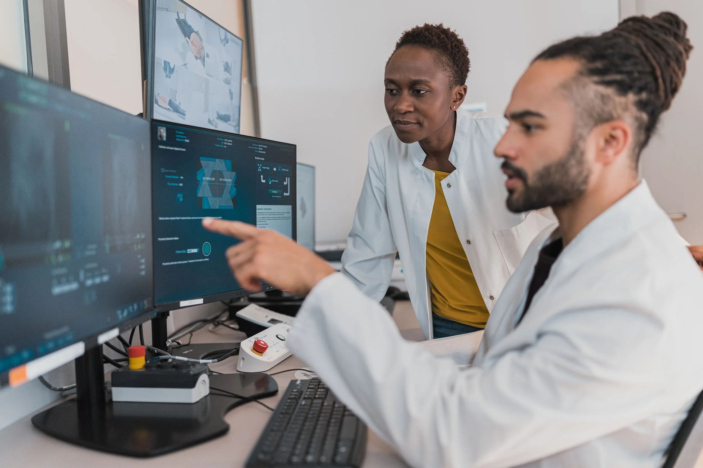

Graduate students, postdoctoral and clinical fellows and residents often take part in research at the MUHC as trainees. What you may do depends above all on whose project it is. You may run a project of your own under a supervisor, or work on a study that someone else leads.

## Run your own project under a supervisor

Many graduate students, fellows and residents run a project of their own, such as their thesis research. [Students, trainees and residents may not conduct research activities independently](/training/compliance-requirements#know-which-credential-you-need), so none of them can be a <Tooltip tip="The investigator who leads the study team at a site and is responsible for conducting the study there." headline="Principal Investigator (PI)" cta="Full definition" href="/kb/foundations/glossary#pi">principal investigator</Tooltip>. You run your project under a supervisor, and the supervisor is the project's principal investigator. Research acts that involve direct interaction with participants may still be [delegated to you](#what-you-can-be-delegated), under the institution's policies.

Before acting as principal investigator, your supervisor must hold [Human Research Privileges, Researcher Status or a written institutional authorization](/training/compliance-requirements#know-which-credential-you-need). Your agreement with the RI-MUHC, your training and your tasks on the Task Delegation Log come [before your first study task](#before-your-first-study-task), as on any study.

The steps your project takes are on the page for its type of study, and [Types of Study](/paths) helps you find which type it is. What only your supervisor may do as principal investigator, and what can be delegated to you, is on [Investigator](/roles/investigator#know-what-you-are-responsible-for-as-principal-investigator). The [Research Facilitator](mailto:research.facilitator@muhc.mcgill.ca) is the first person to ask about clinical research at The Institute, and can help you place the project.

In the project's [Nagano submission](/apps/nagano/guide-03), collaborators such as PhD students can be added for recognition, in a section separate from the co-investigators. Being listed as a collaborator does not affect the regulatory aspects of the submission.

{/* Sources: the MUHC's Regulatory Framework (June 15, 2026), section 3.1.01A, "Students, trainees and residents" ("Students, trainees and residents may not conduct research activities independently and are therefore not eligible to be granted research privileges or researcher status. Research acts involving direct interactions may, however, be delegated to them in accordance with the applicable institutional policies."; quoted from batches/b250-level-v-factcheck/run/regulatory-framework-2026_whitespace-collapsed.txt), through training/compliance-requirements, "Know which credential you need"; SOP-CR-500_06, section 2.0 ("a fellow, resident or medical student cannot conduct research independently and hence, cannot be Sponsor-Investigator, Principal/Qualified Investigator"). That the supervisor is the principal investigator of a project a trainee runs: MF, Nov. 19, 2026 (ledger row 329; FACTS "A trainee's own project: the supervisor is its principal investigator"), as on roles/investigator's opening. The steps and the responsibilities: paths/index and roles/investigator, "Know what you are responsible for as principal investigator" (each responsibility with whether only the principal investigator may carry it out). Nagano: apps/nagano/guide-03, "Section 5 — Local co-investigators and collaborators" ("For recognition purposes, collaborators such as PhD students can be added in a separate section, but this does not affect the regulatory aspects of the submission."), the Hub's Nagano manual (STYLE-HUB part M step 1). The PI pop-up: the glossary's entry, as on the live page. b501 second reader (Nov. 27, 2026; the b478 write-up, scenario 3: what the reader needs next): the supervisor's credential, the Regulatory Framework, section 3.1.01A ("Any person who wishes to act as principal investigator for a research project conducted under the auspices of Santé Québec-MUHC and involving human participants, their personal information and/or biological material must first hold the research privileges, researcher status or written institutional authorization required by this Regulatory Framework"), linked to the home, training/compliance-requirements, "Know which credential you need"; the agreement, training and delegation, a pointer to this page's own "Before your first study task" (its sources there: kb/team/building-your-team; QA's draft SOP-CR-003_11, sections 2.0, 5.2.3 and 5.6.3; SOP-CR-002_09, sections 5.1.2 and 5.6.3), since that subsection sits under "Work on a study someone else leads" and its rules hold for every study (critical rule 3); the Research Facilitator, the homepage's sentence (index, "For any other question about clinical research at The Institute, the Research Facilitator is the first person to ask.") and contacts ("General entry point for any question about clinical research at The Institute"), with "can help you place" as on roles/coordinator. paths/retrospective, "Check credentials and training", times the credential "Before you submit"; the Framework's reference point ("first", before acting as principal investigator) is kept here, and the difference is listed for the coordinator in the b501 record. */}

## Work on a study someone else leads

On a study that another researcher leads, that study's principal investigator delegates your tasks on the <Tooltip tip="The investigator's list of the appropriately qualified people to whom the investigator has delegated significant study-related tasks." headline="Task Delegation Log (TDL)" cta="Full definition" href="/kb/foundations/glossary#tdl">Task Delegation Log</Tooltip> and supervises your work. You may perform only the tasks listed for you on the log, once your training for them is documented.

{/* Sources: SOP-CR-002_09, section 5.3.5 ("The Investigator maintains oversight and responsibility for supervising any individual or party to whom tasks are delegated at the trial site."), section 5.6.1 ("This log is to be completed for site team members who will be involved in the study (i.e. prior to conducting any study-related task).") and section 5.6.3 ("All persons listed on the Task Delegation Log must have already been appropriately trained to conduct the task(s) they are delegated and this training must be documented prior to the individual and the investigator signing the Task Delegation Log."), through kb/team/building-your-team, "Delegate every task on the Task Delegation Log". The TDL pop-up: the glossary's entry. */}

### What you can be delegated

Trainees may be given a wider range of tasks than volunteers. With the training and the delegation for each task, you may:

- Be listed on research protocols.
- Contact and recruit participants, and perform procedures on them, if you have [valid academic insurance](/training/compliance-requirements#who-cannot-work-with-participants).
- Access identifiable patient health records, with the authorization the study needs.
- Perform the study tasks delegated to you on the log, such as data collection, specimen handling and documentation.
- Obtain participants' consent, once you are [trained on the protocol and on the RI-MUHC's standard operating procedures (SOPs) for consent](/kb/recruitment/consent#choose-who-obtains-consent) and the task is delegated to you.

The principal investigator signs your entry on the log to confirm that you are qualified and trained for the tasks delegated to you. You sign and date the log to accept them.

{/* Sources: kb/team/building-your-team, "Add people who are not employees", its table (Research trainee: "Yes, if they have valid academic insurance, with the training and the delegation for the task."; "May be listed on research protocols, or access identifiable health records": "Yes."), the home of these rules; training/compliance-requirements, "Who cannot work with participants" (the condition, "Students without valid academic insurance"; an open question for QA and the Training Advisor, FACTS "Students and academic insurance"); the Regulatory Framework, section 3.1.01A (research acts involving direct interactions "may, however, be delegated to them in accordance with the applicable institutional policies"); SOP-CR-008_08, section 5.1.2 (the person obtaining consent is "qualified by education, experience and documented training to do so (i.e., trained on SOP-CR-006 and this SOP), has trained on the protocol and this training is documented, is knowledgeable in the study procedures and has subsequently been delegated this task by the QI/PI"), through kb/recruitment/consent, "Choose who obtains consent"; SOP-CR-002_09, section 5.1.2 ("the study team members must sign and date the Task Delegation Log in order to accept delegation of protocol tasks on the Task Delegation Log. The Investigator must sign the Task Delegation Log to confirm that each staff member is qualified and trained to conduct the study-specific task(s) that the Investigator is delegating."), through kb/team/building-your-team. The heading is kept: training/compliance-requirements links its anchor. */}

### What you may not do

Some tasks stay out of a trainee's reach, whatever the log says:

- Perform [an activity reserved to a licensed professional](/kb/team/building-your-team#delegate-only-tasks-the-person-is-licensed-to-do), such as drawing blood or giving medication, unless a law or regulation authorizes you. Quebec's [Nurses Act](https://www.legisquebec.gouv.qc.ca/en/document/cs/I-8) and [Professional Code](https://www.legisquebec.gouv.qc.ca/en/document/cs/C-26) reserve these activities, regardless of your delegation.
- Lead a study, or hold Human Research Privileges or Researcher Status.
- Be the principal investigator's backup. The backup must hold Privileges or Researcher Status, which trainees cannot hold. A fellow, a resident or a medical student cannot be the backup.

{/* Sources: the Nurses Act (CQLR c. I-8), sections 36 (activities "reserved to nurses", including "(11) administering and adjusting prescribed medications or other prescribed substances") and 41, and the Professional Code (CQLR c. C-26), section 37.1 (taking specimens and phlebotomies reserved to the members of the orders it names), as in FACTS "Batch 56" (read on LégisQuébec, Nov. 9, 2026; quotes in evidence/laws-quebec_2026-11-08.md: "drawing blood is a reserved activity, but not a nurse-only one"; "whatever the delegation log says"); the Regulatory Framework, section 3.1.01A ("not eligible to be granted research privileges or researcher status"); SOP-CR-002_09, section 5.1.2 ("Appoint a Sub-Investigator with the same qualifications as the Investigator who is qualified and trained to temporarily replace the Investigator if needed. This Sub-Investigator must also obtain RI-MUHC Privileges/Researcher Status (Note: the backup Sub-I cannot be a fellow nor resident as they are not eligible for Privileges/Researcher Status)."); SOP-CR-500_06, section 2.0 ("a fellow, resident or medical student cannot conduct research independently and hence, cannot be Sponsor-Investigator, Principal/Qualified Investigator, nor Sub-Investigator delegated QI/PI responsibilities (i.e. cannot apply for Privileges or Researcher Status)"), as on roles/investigator's backup row. b325 (from pooled look 17b, list 3b): "unless you hold the licence that allows it" became "unless a law or regulation authorizes you", since the laws also let students in a training program act (the Medical Act, section 43 (f): "by students as part of a training program for persons referred to in the regulations made under subparagraph b of section 19, provided they engage in them under the conditions prescribed in the regulation."), and people acting under a regulation made under paragraph h of section 94 of the Professional Code (the Nurses Act, section 41 (b); the Code, section 39.5), such as nursing students and externs under CQLR c. I-8, r. 2; the words "an activity reserved to a licensed professional" now link kb/team/building-your-team, "Delegate only tasks the person is licensed to do", which gives the three laws and their exceptions (evidence/laws-quebec-*_read-2026-11-19.md). */}

### Before your first study task

Every member of a study team must have an agreement with the RI-MUHC before performing any study task or appearing on the Task Delegation Log. Graduate students sign an academic affiliation agreement, postdoctoral fellows a postdoctoral appointment agreement, and trainees who are not students a trainee agreement. People and Culture's [HR Service Centre](mailto:ri.hr.centre@muhc.mcgill.ca) processes [these agreements](/kb/team/building-your-team#hire-staff-and-put-agreements-in-place).

Your training comes next. The highest-risk study you work on sets your training level, not your role, so a trainee on a drug trial needs the same training as a clinical research coordinator on that trial. Before tasks are delegated to you on the Task Delegation Log:

- Complete the [SOP Reader and Assessment](/training/compliance-requirements#sop-reader-and-assessment) in [TalentLMS](/apps/talentlms) for the study's training level. There is no exemption for students. Everyone on a study should hold the study's level, or a higher one, before signing its Task Delegation Log.
- Complete any other training the study's level requires, such as training in good clinical practice (GCP) and Health Canada Division 5 training for a drug study. [Training requirements by study level](/training/compliance-requirements#training-requirements-by-study-level) gives each level's courses. The RI-MUHC's licence with the [CITI Program](/training/external-certifications) makes them free for investigators, staff and trainees.
- Complete your training on the study's protocol and documents. Protocol training may take place at the <Tooltip tip="A monitoring visit conducted by a monitor as a final evaluation of the site, and to train the site team on the study protocol and its associated documents and processes." headline="Site Initiation Visit (SIV)" cta="Full definition" href="/kb/foundations/glossary#siv">site initiation visit</Tooltip>, and it must take place before tasks are delegated to you on the log. Your training must be documented. If you join a study that is already running, your initial training should be documented on a Training Log, including training you give yourself. Training that gives no certificate or dated printout, such as reading the protocol or the Investigator's Brochure yourself, must be documented on a Training Log.

Once your training is documented, the principal investigator adds you to the Task Delegation Log with your tasks and signs your entry, and you sign it to accept them.

When you pass the SOP Reader and Assessment, TalentLMS issues a certificate automatically. Download it and file it with your study training records. Each certificate must stay valid for the whole study. If a certificate expires during your placement, you may not perform delegated tasks until you renew it. [Renew it](/training/compliance-requirements#renew-your-certificate) before it expires. TalentLMS sends reminders before a certificate it holds expires.

When you return from a leave of more than six months, redo the SOP Reader and Assessment and any other training your study level requires, at the level of the studies you will then work on. Other training may be required by your supervisor, or if your study level goes up.

The agreement you sign for access to the MUHC's network and to patients' medical records is the Confidentiality and Security Agreement for Access to MUHC Network - Research. By signing it, you become responsible for the identification code and password you are given to access the MUHC Intranet. Before Medical Records Services gives you access to patients' medical records, sign the [agreement](/kb/governance/privacy#keep-participant-information-confidential) and send it to them.

{/* Sources: kb/team/building-your-team, "Hire staff and put agreements in place" ("All study team members must have an appropriate employment, affiliation or volunteer agreement with the RI-MUHC before performing any study task or appearing on the Task Delegation Log."; its table: "Graduate student | Academic affiliation agreement", "Postdoctoral fellow | Postdoctoral appointment agreement", "Research trainee who is not a student | Trainee agreement", each "The HR Service Centre"; no primary source found there, asked of People and Culture and QA, B125, B126); QA's draft SOP-CR-003_11 (a draft: effective date "XX-XXX-2027"; its accepted text, batches/b101-recheck16-fixes/run/web/sop-cr-003_11_accepted.txt), section 2.0 ("All Sponsor-Investigators, QI/PIs and all RI-MUHC/MUHC personnel, students (including but not limited to those performing an academic stage), research fellows and residents conducting MUHC research on human participants"; "are required to obtain documented training prior to study task delegation and conducting any task related to the study"), section 5.2.3 (one level, set by the highest-risk study) and the paragraph after section 5.2.4 (team members "should obtain the same institutional training level (or better i.e., highest risk) prior to signing the study Task Delegation Log"), through training/compliance-requirements; section 5.6.3 ("Protocol and study documentation training must be provided to the research teams by the Sponsor or Sponsor-Investigator, or delegate, who is thoroughly familiar with all aspects of the study. This may occur at the Site Initiation Visit (SIV) meeting and must occur prior to staff delegated tasks on the study Task Delegation Log."; "Subsequent initial training of new staff should be documented on a Training Log (including self-training)."), through kb/conduct/study-operations/team-management, "Add a new team member"; training/external-certifications, its opening (the RI-MUHC's CITI licence, "free access to GCP and Health Canada Division 5"); SOP-CR-019_07, RI-MUHC Addendum, section 1.2.1 ("An MUHC confidentiality agreement must be signed and sent to Medical Records Services prior to them providing an individual's access to patient's medical records (Refer to Appendix 1 )."), through kb/governance/privacy, "Keep participant information confidential"; SOP-CR-002_09, sections 5.1.2 and 5.6.3, through kb/team/building-your-team; kb/conduct/study-operations/team-management, "Check the log at every update" ("A team member whose certificate has expired may not perform delegated tasks until they renew it."); training/compliance-requirements, opening ("Each certificate must stay valid for the whole study. Renew it before it expires.") and "Validity and the 90-day rule" (the reminders; the periods and the days are not repeated here, STYLE-HUB B3). Added in b299 (second reader; the b297 fact check's A findings): the lead-in's reference point, section 2.0 ("required to obtain documented training prior to study task delegation"); section 5.7.2 ("For training which does not provide a certificate or dated printout (e.g., ISO-14155 GCP document, protocol or IB self-training/reading), this training must be documented on a Training Log"), with section 5.6.3's "should" for new staff, as on kb/conduct/study-operations/team-management, "Add a new team member"; section 5.2.4 ("Once SOP Reader reading is completed and the quiz is passed, the SOP Training will display as Completed/100% and a certificate will be automatically issued. Ensure you download and file this certificate with your study training records."); sections 5.8.1 ("In the event of a leave-of-absence exceeding 6 months, human research team members will be required to redo their institutional training at the appropriate training level based on studies to be conducted upon their return.") and 5.8.2 ("Other training may be required based on their supervisor's requirements and if the study level needs to be upgraded."), as on roles/crc-guide, with the training the level requires named (sections 5.2 and 5.3), since this page's "institutional training" section is the five TalentLMS courses; SOP-CR-019_07, Appendix 1, its title ("Confidentiality and Security Agreement for Access to MUHC Network - Research") and item 1 ("I am responsible for my identification code and password issued to me to access the MUHC Intranet."). The agreement's sentence moved out of the list, whose lead-in now dates every item by delegation. The SIV pop-up: the glossary's entry, as on the live page. b311 (the b310 check's C row 1.3, one safe edit): "by reading" went, since QA's draft SOP-CR-003_11, section 5.6.3, says "(including self-training)", with no means named. */}

### Complete the institutional training

Every member of The Institute, research trainees and postdoctoral fellows included, must complete five [institutional training courses](/apps/talentlms#mandatory-institutional-training) in TalentLMS. The five courses are separate from the SOP Reader and Assessment:

- Let's Be Allies: Foundations in Equity, Diversity, and Inclusion
- Cybersecurity Basics at The Institute
- Prevention of Violence and Psychological Harassment in the Workplace and Research Space
- Creating a Culture of Care: Understanding Intimate Partner, Family and Sexual Violence in the Workplace
- MUHC Emergency Measures

Complete them before your first study task.

{/* Sources: apps/talentlms, "Mandatory institutional training" ("All members of the RI-MUHC — administrative staff, researchers, research trainees, postdoctoral fellows, laboratory personnel, and research staff — must complete the following five institutional training courses."; the five course titles, word for word, STYLE-HUB part I); no primary source found for the requirement or for its timing ("Complete all steps before performing any study tasks", the live page's Steps; the page is not yet rewritten; owner: the Training Advisor). Indra's ledger row 27: the courses as a list. */}

### Work under supervision

You work under the supervision of the study's principal investigator for the whole placement:

- If you are not sure whether a task is delegated to you, or how to handle a situation, consider asking the principal investigator before you act.
- If your tasks change, the log must be updated and signed by the principal investigator before you perform the new tasks.
- When the protocol or a study document such as the Investigator's Brochure is amended, you must be trained on the amendment in a timely fashion, directly after the <Tooltip tip="A body, not affiliated with the sponsor, whose main mandate is to approve the start of biomedical research involving human participants and to review it periodically, to protect the participants' rights, safety and well-being." headline="Research Ethics Board (REB)" cta="Full definition" href="/kb/foundations/glossary#reb">Research Ethics Board (REB)</Tooltip> approves it.
- If you witness a possible safety issue, protocol deviation or confidentiality concern, report it immediately to the principal investigator or the study's coordinator.
- When your placement ends, the principal investigator records your end date on the log.

{/* Sources: SOP-CR-002_09, section 5.6.1 ("This log should be maintained up-to-date throughout the study."), section 5.6.3 (training documented "prior to the individual and the investigator signing the Task Delegation Log") and Appendix 1, footnote ** ("any changes in staff or delegated study tasks will be documented"; "Grey area to be completed when staff exit"; the log's "End Date" column), through kb/conduct/study-operations/team-management, "Keep the Task Delegation Log up to date" and "Record a team member who leaves"; QA's draft SOP-CR-003_11, section 5.6.4 ("Staff must also be trained on amendments of any protocol or study document (e.g., IB) in a timely fashion (i.e., directly after REB approval)."), through kb/conduct/study-operations/team-management, "Add a new team member" (an addition, a requirement of the page's own source, V3-TRACE P27). None found: who records the end date (the live page's "your PI records your end date"), and the reporting of a concern to the principal investigator or the coordinator (the live page's; owner: QA). The first item is the Hub's own advice (STYLE-HUB A1). The REB pop-up: the glossary's entry. */}

## Who is a research trainee

A research trainee is a student enrolled in a Canadian university program, or a postdoctoral fellow, working under the supervision of a principal investigator at The Institute. Trainees include undergraduate students, MSc and PhD candidates, clinical (MD) fellows and postdoctoral fellows. Postdoctoral fellows must be registered with McGill University.

A student is onboarded as a volunteer instead of a trainee if they are not enrolled in a Canadian university program, or if their work on the study is not related to their own thesis or research. A [volunteer](/roles/volunteer-observer) may do fewer tasks than a trainee.

{/* Sources: kb/team/building-your-team, "Add people who are not employees" (the table's "A student enrolled in a Canadian university program, or a postdoctoral fellow, working under the supervision of a principal investigator at The Institute."; "A student is onboarded as a volunteer instead of a trainee if they are not enrolled in a Canadian university program, or if their work on the study is not related to their own thesis or research."), the home; no primary source found for the definition, the levels or the McGill registration (leads only: the Research Trainee Handbook 2025, "Trainees may be appointed at the undergraduate, MSc, PhD, clinical (MD) fellow, or postdoctoral fellow level."; "postdoctoral fellows must be registered with McGill University"; owner: People and Culture). */}

## Fellows and residents

Fellows and residents may work on a study, but they may not conduct research independently. The rules for them on a research team have [their home on Building Your Research Team](/kb/team/building-your-team#fellows-and-residents-on-a-research-team):

- A medical assessment by a fellow or a resident must be co-signed by the principal investigator or a qualified <Tooltip tip="A qualified member of the study team, designated and supervised by the qualified or principal investigator at a site, who performs critical investigator tasks as described on the Task Delegation Log or makes important trial-related decisions." headline="Sub-Investigator" cta="Full definition" href="/kb/foundations/glossary#sub-investigator">sub-investigator</Tooltip> with Privileges or Researcher Status.
- Fellows and longitudinal residents can be named sub-investigators, but they cannot replace the principal investigator. The Task Delegation Log must show exactly which duties they may carry out.
- On the Task Delegation Log and other essential study documents, fellows and residents should generally not be named sub-investigators. The log can name fellows, residents and medical students as a student, a fellow, a resident or a research assistant.
- Residents on rotation cannot be named sub-investigators.
- For a grant application, fellows and residents can be listed as sub-investigators on the protocol or the grant proposal.

Some departments make an exception and give fellows and longitudinal residents the title "Sub-I (fellow)" or "Sub-I (longitudinal resident)". These fellows and residents must not be delegated the principal investigator's tasks without supervision, and they cannot be the principal investigator's backup.

The principal investigator must ensure that any of the principal investigator's tasks these fellows and residents carry out is under the principal investigator's direct, documented supervision, with every medical assessment co-signed by the principal investigator or a sub-investigator with Privileges. The log should clearly show this supervision. The department should write its own SOP that says which tasks it delegates to fellows or longitudinal residents and how it supervises them.

{/* Sources: SOP-CR-500_06, section 2.0 ("a fellow, resident or medical student cannot conduct research independently"); SOP-CR-002_09, section 5.3.3, its Note ("Fellows and residents must not conduct human research independently. If conducting medical assessments, they must be co-signed by the QI/PI or the qualified Sub-Investigator with Privileges/Researcher Status."), section 5.1.2 ("Fellows and longitudinal residents can be named as sub-investigators but cannot replace the Investigator"; "Note: Residents on rotation cannot be named Sub-Is.") and section 5.6.2 ("For the purposes of grant applications, fellows and residents can be listed as Sub-Investigators on the protocol or grant proposal. In general, they should not however, be named as Sub-Investigator on the Task Delegation Log and other study essential documentation. On the Task Delegation Log fellows, residents and medical students can be named as student, fellow, resident or research assistant."; the departmental exception: "these Sub-Is must not be delegated unsupervised QI/PI tasks and can not be the QI/PI backup. The QI/PI must ensure that any QI/PI tasks conducted by a fellow or longitudinal resident is under the direct documented supervision of a QI/PI (i.e. all medical assessments are co-signed by the QI/PI/Sub-I with Privileges)"; "the department should write a department-specific SOP to detail which tasks will be delegated to a fellow or longitudinal resident and how they will be supervised."), each in the words of kb/team/building-your-team, "Fellows and residents on a research team", the home. "Sub-investigator" for the SOPs' role (U01 1612). Added in b299 (second reader; the b297 fact check's P5 and C row T51), in the home's words: section 5.1.2's "the Task Delegation log must reflect exactly what duties may be carried out by fellows and longitudinal residents", and section 5.6.2's "The QI/PI must ensure" and "this should be clearly indicated on the Task Delegation Log". The Sub-Investigator pop-up: the glossary's entry, as on roles/investigator. b468 second reader (an owed item): "and they cannot be the principal investigator's backup", in the home's words (kb/team/building-your-team, "Fellows and residents on a research team"), from section 5.6.2's "can not be the QI/PI backup". */}

## Keep participant information confidential

The MUHC Confidentiality and Security Agreement you sign is separate from any confidentiality agreement with a study's sponsor, which covers the sponsor's proprietary information. The rules for participants' information are the same for you as for any team member:

- Never discuss participant information outside the research team.
- Do not photograph or copy documents that contain patient information.
- Handle identifiable data only within the scope that the REB has authorized.

By signing the [MUHC Confidentiality and Security Agreement](/sops/cr-019#appendix-1), you take on these duties as well:

- Never browse patient records, or access records that your work does not require.
- Destroy information in a secure manner, in accordance with current industry standards, after the project has been completed or when the information is no longer required.
- Never share your password, and take all reasonable precautions to protect the privileges assigned to you.
- Log off from the workstation when your work is done or when you leave it unattended.
- Report improper or illegal activities immediately to your superior, or directly to the Security and Confidentiality coordinator through 58484.

Your obligations of confidentiality continue after your placement ends. Understand the obligations that [the applicable privacy legislation and the institution's policies and procedures](/kb/governance/privacy) impose on you, and what they mean for your day-to-day work.

{/* Sources: kb/governance/privacy, "Keep participant information confidential" ("The MUHC agreement is separate from any confidentiality agreement with the sponsor, which covers the sponsor's proprietary information."; "Collect data only for the REB-approved study."), from SOP-CR-019_07 and its Appendix 1 (item 3: "I will not attempt to access information, which is not required to carry out my day-to-day responsibilities."; item 4: "I will not reveal nor transmit by any means, patient's information or other MUHC's information which I have access, susceptible to compromise the confidentiality, data security of MUHC."). None found: "do not photograph or copy", and that the obligations continue after the placement (the live page's; owner: QA). Added in b299 (second reader; the b297 fact check's P3 and P6): SOP-CR-019_07, Appendix 1, item 3 ("Browsing through patient records or accessing records that are not required for my work is strictly prohibited."), item 5 ("Information shall be destroyed in a secure manner, and in accordance with current industry standards, after the project has been completed or when the information is no longer required.") and item 8 ("Such reports must be made immediately to my superior or directly to the Security and Confidentiality coordinator through 58484."), /sops/cr-019#appendix-1 (item 8 as on kb/governance/privacy, "Report information that is lost or seen by the wrong person"); QA's draft SOP-CR-003_11, section 5.5.1 ("All study team members must understand the obligations imposed by the applicable privacy legislation and institutional policies and procedures, and the implications to their day-to-day practice."), on the page's existing link to kb/governance/privacy, which replaces the sentence "Privacy and Confidentiality in Research gives the RI-MUHC's rules for participants' information in full." (a pointer). The REB is defined, with its pop-up, at its first use under "Work under supervision". b311 (the b310 check's A finding 4, a requirement of the page's own source, P27): SOP-CR-019_07, Appendix 1, items 6 ("I will not share my password and I will take all reasonable precautions to protect the privileges assigned to me.") and 7 ("It is my responsibility to log-off from the workstation when my work is completed or when I leave my workstation unattended."), added in the form's order, as roles/volunteer-observer, "Keep participant information confidential", carries them for the same form. */}

## Employment status and stipend

Research trainees are not employees of the RI-MUHC. You receive a stipend or bursary from your supervisor's research grant. The stipend is administered as a scholarship. It supports your academic progression and thesis work, and it is treated as a scholarship for tax purposes, with T4A and Relevé 1 tax slips. Postdoctoral fellows are the exception, since federal income tax is deducted directly from their stipend.

Your status does not change your compliance obligations. The SOP Reader and Assessment, the Task Delegation Log and the confidentiality requirements apply to trainees as they do to employees.

{/* Sources: none found for the stipend, its tax treatment or the postdoctoral exception. Cut in b299 (the b297 fact check's T59; for MF): "not processed through RI-MUHC payroll", after "administered as a scholarship"; no source found, and the only lead says the opposite (below) (leads only: the Research Trainee Handbook 2025, "Research trainees are not considered employees and do not have assigned deliverables or employment contracts. The stipend is meant to support your academic progression and is treated as a scholarship for income tax purposes. You will receive a T4A and Relevé 1 tax slip indicating this."; "Exception: Postdoctoral fellows are also considered research trainees, but unlike other trainees, federal income tax is deducted directly from their stipend."; and, against the payroll sentence, "All stipend payments are administered through The Institute’s payroll system and can be accessed through eEspresso on the Portal."; owner: People and Culture, as on kb/team/building-your-team's hidden comment under "Add people who are not employees"). The compliance obligations: QA's draft SOP-CR-003_11, section 2.0 (students within its scope); SOP-CR-002_09, section 2.0 (the SOP concerns "employees, Sponsor-Investigators, Investigators, physicians, management, consultants, fellows, residents, students, volunteers or other persons"). */}

## Find guidance for your delegated tasks

The Task Delegation Log says what you may do. For how to do each task, start from its page, the same one every team member uses:

| If you are delegated | Start here |
|---|---|
| Data collection, <Tooltip tip="A printed, optical or electronic document designed to record all the protocol-required information to be reported to the sponsor on each trial participant." headline="Case Report Form (CRF)" cta="Full definition" href="/kb/foundations/glossary#crf">case report form</Tooltip> entry or query resolution | [Data Integrity](/kb/conduct/data-documentation/data-integrity), and for electronic data capture systems, [EDC and Query Management](/kb/conduct/data-documentation/edc-query-management) |
| Informed consent discussions | [Informed Consent](/kb/recruitment/consent) |
| Recruitment or screening | [Recruitment, Screening and Enrolment](/kb/recruitment/recruitment-enrollment) |
| Specimen collection, processing or shipping | [Management of Biological Specimens](/kb/conduct/study-operations/biological-specimens) |
| <Tooltip tip="Any untoward medical occurrence in a participant who has been given an investigational product, whether or not it is related to that product." headline="Adverse Event (AE)" cta="Full definition" href="/kb/foundations/glossary#ae">Adverse event</Tooltip> documentation or safety reporting | [Reportable Events](/kb/conduct/safety-reporting/reportable-events) |
| Protocol deviation documentation | [Deviation Management](/kb/conduct/safety-reporting/deviation-management) |
| Upkeep of the <Tooltip tip="The qualified or principal investigator's collection of study documentation that demonstrates compliance with regulations and guidelines, so that the conduct and integrity of the study and the safety of participants at the site can be verified." headline="Investigator Site File (ISF)" cta="Full definition" href="/kb/foundations/glossary#isf">investigator site file</Tooltip> or the study files | [The Investigator Site File](/kb/site-activation/isf) |
| Preparing for a monitoring visit | [Monitoring, Audits and Inspections](/kb/conduct/safety-reporting/monitoring-audits) |
| Putting a study amendment in place | [Study Amendments](/kb/conduct/safety-reporting/study-amendments) |
| Retrospective data extraction or chart review | [Privacy and Confidentiality in Research](/kb/governance/privacy) and [Retrospective and Biobank Studies](/paths/retrospective) |

{/* Sources: none needed (links to the Hub's pages; the pop-ups are the glossary's entries, as on the live page). Changed: the live table's last row linked the CRC guide for Levels IV and V, and a sentence under the table linked both CRC guides, which the role-page rewrite retires (MASTER-PLAN step 5); the row now links the path for retrospective studies, and the sentence is cut as a pointer, listed for MF. */}

## Get support

Two institutions support you as a research trainee: your university and The Institute. Your supervisor is your main contact for research questions, study tasks and day-to-day supervision. If challenges arise, such as unclear expectations, a lack of communication or concerns about your progress, speak with your Graduate Program Advisor or Director first. For confidential advice, McGill's Ombudsperson for Students is open to every McGill-registered trainee.

| Concern | Who handles it |
|---|---|
| Academic program, thesis and coursework | Your graduate program's staff, or McGill's Graduate and Postdoctoral Studies (GPS) |
| Issues with supervision or with your supervisor | GPS, or the Ombudsperson for Students |
| Scholarships, registration and student life | GPS, or McGill's Enrolment Services |
| Stipend, eEspresso and payroll questions | People and Culture's [HR Service Centre](mailto:ri.hr.centre@muhc.mcgill.ca), at The Institute |
| Research space, safety and workplace conduct | Your supervisor, or your research program's staff, at The Institute |
| Harassment or inappropriate behaviour | McGill's Office for Mediation and Reporting, or the Ombudsperson for Students |
| Career and professional development | McGill's Career Planning Service (CaPS) and SKILLSETS, or the Desjardins Centre for Advanced Training (DCAT) and Tremplin, at The Institute |
| Clinical research compliance | The study's principal investigator, [Quality Assurance (QA)](mailto:QAClinicalResearch@muhc.mcgill.ca) or the [Research Facilitator](mailto:research.facilitator@muhc.mcgill.ca), at The Institute |

If you are registered at a university other than McGill, your home university remains responsible for your academic registration, program progress and student services.

{/* Sources: none found (leads only: the Research Trainee Handbook 2025, "Navigating Academic Life": "As a research trainee, you're supported by two institutions: your university (e.g., McGill University) and The Institute."; its table of who to contact; "If you are a research trainee from another Canadian university, your home institution remains responsible for your academic registration, program progress, and student services."; and "Start by speaking with your supervisor if you feel comfortable doing so. If unresolved, contact your Graduate Program Advisor or Graduate Program Director. For confidential, impartial advice, reach out to the Ombudsperson for Students.", which puts the supervisor before the Graduate Program Advisor, for MF). The names of McGill's services: the Career Planning Service's and SKILLSETS' own pages (saved, run/web/mcgill-caps.txt and mcgill-skillsets.txt, Nov. 19, 2026). The HR Service Centre's, QA's and the Research Facilitator's addresses as on kb/team/building-your-team's and training/compliance-requirements' Contacts. Changed: the table had a column for each institution, with a dash in the empty cells; it is now one column (core F5: no empty cells). */}

## Resources for trainees

If you are new to clinical research, start with [Clinical Research 101](/kb/foundations/clinical-research-101) to learn how research differs from clinical care, the phases of a drug trial, the roles in a study and which rules apply to research at the MUHC.

The *Research Trainee Handbook* covers the day-to-day essentials: Portal access, ID cards, stipend payments and eEspresso, IT support, web apps, campus logistics, lab safety and institutional training courses. Ask your supervisor or your program's staff for a copy if you have not received one.

The Desjardins Centre for Advanced Training (DCAT) offers professional and career development to life science researchers at every level, from undergraduate students to postdoctoral fellows. DCAT is the only program of its kind in Quebec located within a health research institute. DCAT holds four career seminars during the year:

- Demystifying Your Career Options
- Must-Know Tips for Job or Internship Hunting
- Confidence in Connection: Breaking Down Barriers for Career Growth
- Identifying and Leveraging My Transferable Skills

Its career exploration programs include Future in Focus (the Precision Medicine Career Insight and Discovery Program) and the Career Spark Networking Lunch and Career Day. DCAT also offers one-on-one career advising, and mentorship activities that connect trainees with professionals in science, policy, health care and innovation.

DCAT is a partner in the Tremplin Consortium of McGill-affiliated health centres, funded by the Fonds de recherche du Québec (FRQ). To join The Institute's trainee newsletter, write to [DCAT](mailto:dcat@muhc.mcgill.ca).

The Canadian Consortium of Clinical Trial Training Platforms (CANTRAIN) is Canada's national clinical trials training platform. [CANTRAIN](/training/cantrain) is free for RI-MUHC investigators, staff and trainees.

CANTRAIN's Stream 1, the Graduate and Postdoctoral Trainee Career Development Program, is offered through the DCAT and Tremplin partnership. The program covers clinical trial methodology, regulatory frameworks and careers in clinical research. The Common Core Foundation gives every stream a shared baseline. [CANTRAIN courses may be eligible](/training/cantrain#socra-and-acrp-certification-credits) for maintenance of certification credits with SOCRA and ACRP.

{/* Sources: DCAT's own slide (Unsorted/DCAT Slide Fall 2025.pdf; evidence, for FACTS) gives "the only program of its kind in Quebec located within a health research institute", the four seminars' titles, "Future in Focus: Precision Medicine Career Insight and Discovery Program", "Annual Career Spark Networking Lunch and Career Day" and "To learn more or join The Institute’s Trainee Newsletter, email dcat@muhc.mcgill.ca"; DCAT's 2024-25 Impact Report says "Quebec’s first research institute to align career development support with research training" and names the program "Future in Focus: Precision Medicine Career Discovery Program" (and, on its timeline, "Career Interest and Discovery"): for DCAT. None found for the handbook's contents or for DCAT otherwise (leads only: the Research Trainee Handbook 2025, its contents list; "As the only program of its kind in Quebec housed within a health research institute, DCAT provides professional and career development opportunities tailored to life science researchers at every level—from undergraduate and graduate students to postdoctoral fellows."; the four career seminars' full titles, which the page now gives instead of the live page's shortened ones ("Demystifying Your Career Options", "Must-Know Tips for Job or Internship Hunting", "Confidence in Connection: Breaking Down Barriers for Career Growth", "Identifying and Leveraging My Transferable Skills"); the career exploration programs and advising ("Future in Focus: Precision Medicine Career Insight and Discovery Program", "Networking: Annual Career Spark Networking Lunch and Career Day", "Career Advising", "Mentorship Activities"); "DCAT is a partner in the Tremplin Consortium of McGill-Affiliated Health Centres, funded by the Fonds de recherche du Québec (FRQ)."; "CANTRAIN’s Graduate and Postdoctoral Trainee Career Development Program offered by TREMPLIN & DCAT"; "To join The Institute’s Trainee Newsletter, email dcat@muhc.mcgill.ca."; owner: DCAT). CANTRAIN: training/cantrain, its "Stream 1 — Graduate and Postdoctoral Trainees" card, its Note ("access is free for all RI-MUHC PIs, research coordinators, trainees, and other affiliated personnel"), "Common Core Foundation" and "SOCRA and ACRP certification credits" ("CANTRAIN courses may be eligible for continuing education (CE) credits toward maintaining SOCRA and ACRP certifications."); FACTS "Batches 44 and 45". The Common Core Foundation's number of courses lives on training/cantrain (STYLE-HUB B3), which gives it two ways (a table of 14 modules; "the 11 courses"): for MF. Changed: the DCAT list's bold labels became a list of the seminars' names and two sentences (STYLE-HUB H; core F3: no label colons in items). */}

## Follow the critical rules

Each of these rules applies to the tasks you are delegated, on every study you work on:

- Do not start any research activity, including recruitment, data collection or analysis, until you have both REB approval and MUHC Authorization.
- All required signatures must be on the current REB-approved consent form before any screening procedure takes place. A procedure done even minutes before all the required signatures are on the form is a deviation.
- Do not perform a study task until your training for it is documented and the task has been delegated on the Task Delegation Log.
- Report every serious adverse event to the sponsor within 24 hours of the principal investigator learning of it, unless the REB-approved protocol sets a different timeline.
- If REB approval lapses, do not enrol anyone, and suspend study activities unless stopping them would put participants at risk.

Every Knowledge Base page applies to your studies as its "Applies to" strip shows, and a section with its own strip applies to the studies that strip names.

{/* Sources: STYLE-HUB B3, the five critical rules word for word (SOP-CR-007_08, section 3.0, and the Regulatory Framework, section 3.1.02; SOP-CR-008_08, section 5.1.19; SOP-CR-002_09, section 5.6.1, SOP-CR-003_10, section 5.3, and SOP-CR-007_08, section 5.4.11; SOP-CR-012_08, section 5.4.1; FACTS "REB continuing review"); STYLE-HUB F2 (the sentence on the "Applies to" strips, as on roles/investigator; MF, ledger rows 187 and 262). */}

## Contacts

| Write to | About |
|---|---|
| The Research Facilitator, [research.facilitator@muhc.mcgill.ca](mailto:research.facilitator@muhc.mcgill.ca) | Placing your study, RI-MUHC processes and SOPs. |
| People and Culture's HR Service Centre, [ri.hr.centre@muhc.mcgill.ca](mailto:ri.hr.centre@muhc.mcgill.ca) | Hiring, onboarding, role changes, leaves, offboarding and agreements, and finding your HR Advisor. |
| Quality Assurance (QA), [QAClinicalResearch@muhc.mcgill.ca](mailto:QAClinicalResearch@muhc.mcgill.ca) | Questions about the SOPs and the content of the SOP Reader and Assessment. |
| The RI-MUHC's Training Advisor, [training-formation@muhc.mcgill.ca](mailto:training-formation@muhc.mcgill.ca) | Questions about TalentLMS and the training records it keeps. |
| DCAT, [dcat@muhc.mcgill.ca](mailto:dcat@muhc.mcgill.ca) | Career development, and joining The Institute's trainee newsletter. |

{/* Sources: the Research Facilitator's row as on roles/investigator; the HR Service Centre's as on kb/team/building-your-team; QA's and the Training Advisor's as on training/compliance-requirements; DCAT's address as on the live page (lead: the Research Trainee Handbook 2025, "email dcat@muhc.mcgill.ca"). */}

{/* Checked against: SOP-CR-002_09 (June 19, 2023) and its Appendix 1; SOP-CR-500_06 and SOP-CR-008_08 (May 1, 2025); SOP-CR-019_07 and its RI-MUHC Addendum, as in the All-in-One of Dec. 12, 2024; QA's draft SOP-CR-003_11 (a draft: its cover's effective date is "XX-XXX-2027"; the file is dated June 3, 2026); the Regulatory Framework for Clinical Research at Santé Québec – McGill University Health Centre (approved June 15, 2026), section 3.1.01A; the Nurses Act and the Professional Code, through FACTS "Batch 56"; leads only: the Research Trainee Handbook 2025; the Hub's pages as rendered at localhost:3333 on Nov. 19, 2026. Batch b294 (Nov. 19, 2026): the Trainee page on its own, opening with two cases (STYLE-HUB F2; MF, ledger rows 325, 327 to 329). */}

Last reviewed: November 2026.

import HubDisclaimer from '/snippets/hub-disclaimer.mdx';

<HubDisclaimer />
