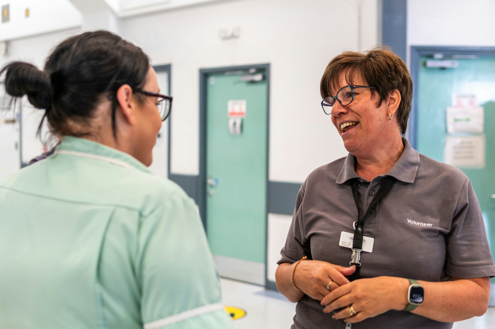

A research volunteer gives their time to a study without employment status, and supports the study team under supervision. Volunteers are not paid through RI-MUHC payroll and have no employment contract.

An observer visits a research site to watch and learn. Observers are not members of the research team, are not listed on the <Tooltip tip="The investigator's list of the appropriately qualified people to whom the investigator has delegated significant study-related tasks." headline="Task Delegation Log (TDL)" cta="Full definition" href="/kb/foundations/glossary#tdl">Task Delegation Log</Tooltip> and do no study task.

A student enrolled in a Canadian university program whose work on the study relates to their own thesis or research may qualify as a [research trainee](/roles/trainee) instead of a volunteer. Trainees have a broader task scope. An observer who wants to contribute to study activities needs to be onboarded as a volunteer or a research trainee, which are different processes with different eligibility requirements.

{/* Sources: kb/team/building-your-team, "Add people who are not employees", its table ("A person who gives their time to a study without employment status. Volunteers are not paid through RI-MUHC payroll and have no employment contract."; "A visitor who watches research activities without doing any study task."; observers on the Task Delegation Log: "No.") and the sentence under it ("A student is onboarded as a volunteer instead of a trainee if they are not enrolled in a Canadian university program, or if their work on the study is not related to their own thesis or research."); the live pages roles/volunteer (opening: "you support a study under supervision"; its Eligibility Note: "If you are a student enrolled in a Canadian university program and the work relates to your thesis or academic research, you may qualify as a research trainee instead of a volunteer — trainees have a broader task scope.") and roles/observer ("An observer visits a research site to watch and learn. Observers are not members of the research team, are not listed on the Task Delegation Log, and cannot perform any study tasks."; its Note: "different processes with different eligibility requirements"). No primary source found for the two definitions or the observer's rules (searched tools/_sources_text/ and FACTS for "observer" and "volunteer"; questions for People and Culture in the batch record). One page for volunteers and observers: MF, ledger rows 327 and 331. */}

## Know what volunteers and observers may do

Volunteers may do supervised tasks that do not involve participants, once the tasks are delegated to them on the Task Delegation Log. Observers watch and do no study task.

<Warning>
Volunteers and other people who are not affiliated with the RI-MUHC or the MUHC may not contact or recruit research participants, or perform procedures on them, at the RI-MUHC or the MUHC, because they are not covered by professional or academic liability insurance.
</Warning>

| | Volunteer | Observer |
|---|---|---|
| Be listed on the Task Delegation Log | Yes, for tasks that do not involve participants, once trained. | No. |
| Do study tasks | Yes, once a task is delegated on the log. File, photocopy, organize study binders, schedule, prepare materials, enter data from de-identified sources or coded data, and support logistics. | No. Observers perform no protocol-related task: no data entry, filing, specimen handling or document preparation. |
| Contact, recruit or perform procedures on participants | No. | No. Observers do not interact with participants in any capacity. |
| Access identifiable patient health records, such as those in OACIS, the MUHC's electronic medical record, in medical charts or in any system that holds patients' names, medical record numbers or dates of birth | No. | No. Observers do not access study documents, patient records or institutional systems either. |
| Be listed on research protocols | No. | No. |
| Take part in study submission | No. | No. Observers do no study task. |
| Perform acts reserved to a licensed professional, such as blood draws, giving medication or medical assessments | No. | No. Observers do no study task. |

Observers may watch research activities, team workflows and site operations. Observers may also attend team meetings and training sessions, and ask the research team questions outside participant interactions.

The supervising <Tooltip tip="The investigator who leads the study team at a site and is responsible for conducting the study there." headline="Principal Investigator (PI)" cta="Full definition" href="/kb/foundations/glossary#pi">principal investigator</Tooltip> delegates a volunteer's tasks on the log, within these limits. Violations of these restrictions are reportable events with serious consequences for the study and for the supervising principal investigator. If you are ever asked to do something you are unsure about, consider asking your supervisor before you do it.

[Who cannot work with participants](/training/compliance-requirements#who-cannot-work-with-participants) lists everyone the rule on participants covers.

{/* Sources: SOP-CR-003_10, section 2.0, its Note, and QA's draft SOP-CR-003_11, section 2.0, its Note (the same text; the draft's accepted text, batches/b101-recheck16-fixes/run/web/sop-cr-003_11_accepted.txt, line 45): "Non-affiliated RI-MUHC/MUHC members (including volunteers) are not allowed to contact, recruit and/or perform procedures on a research participant at the RI-MUHC/MUHC as they are not covered by professional or academic liability insurance." The Warning is the wording of kb/team/building-your-team's Warning, word for word. training/compliance-requirements, "Who cannot work with participants" ("The people in this list may not be listed on protocols, access identifiable patient health records or take part in study submission either."; "Once added to the Task Delegation Log, volunteers may do administrative and other tasks that do not involve participants, such as filing, entering de-identified data and handling logistics. Volunteers may not interact with participants."), the home of the list; kb/team/building-your-team, the table ("Yes, for tasks that do not involve participants, once trained."; "No." for observers on every row); SOP-CR-002_09, section 5.1.2 (the Investigator signs the log "to confirm that each staff member is qualified and trained"); the live pages for the task examples, the observer's rows and the reserved acts (roles/volunteer, "What you can and cannot do"; roles/observer, "What observers can and cannot do"). Not found in any source: whether volunteers may be on the log at all (asked of QA and People and Culture, B125, B126, B160, B193); "Violations … are reportable events" (QA); the observer's rows (People and Culture). The volunteer's "can" items start with verbs: Indra, ledger rows 28 and 29. "Consider asking your supervisor": the Hub's own advice, with no source found (b296 fact check, row 24; STYLE-HUB A1; b298). */}

## Arrange the agreement before the first day

People and Culture, the RI-MUHC's human resources (HR) division, onboards volunteers and observers through its [HR Service Centre](mailto:ri.hr.centre@muhc.mcgill.ca). Each needs [the agreement for their role](/kb/team/building-your-team#hire-staff-and-put-agreements-in-place): a volunteer agreement or an observer agreement. Complete every step before any work or any visit begins.

### Arrange a volunteer placement

To volunteer at the RI-MUHC, you must:

- Be eligible to work in Canada, as a Canadian citizen or a permanent resident, or with a valid work or study permit.
- Hold at least a high school leaving certificate.

Before the first day, the HR Service Centre needs these documents:

- A Supervisor's Authorization form, signed by the principal investigator who will supervise the placement. The form confirms that the principal investigator takes responsibility for your activities and training.
- The [MUHC Confidentiality and Security Agreement](/sops/cr-019#appendix-1), signed before you access any RI-MUHC system or are present in an area where patient information may be visible.
- Proof of eligibility to work in Canada, such as proof of citizenship or permanent residency, or a valid work or study permit.

Once these are in place, the principal investigator adds you to the study's Task Delegation Log with your specific tasks, within the limits above, and signs to confirm that you are qualified and trained for them. You sign and date the log to accept the tasks. Do no study task before the log is complete. Ask the HR Service Centre or your supervising principal investigator for the full volunteer onboarding checklist and the forms.

### Prepare for an observer visit

Sign the [MUHC Confidentiality and Security Agreement](/sops/cr-019#appendix-1) before you begin observing, and before you enter any area where patient or participant information may be visible. The hosting principal investigator or the <Tooltip tip="A nurse, health professional or other qualified member of the research team who handles most of the administrative responsibilities and day-to-day activities of a clinical trial." headline="Clinical Research Coordinator (CRC)" cta="Full definition" href="/kb/foundations/glossary#crc">clinical research coordinator</Tooltip> provides the form.

The hosting principal investigator or the coordinator should also brief you on the site's rules, where you may and may not go, and what to do if you see something that concerns you. For anything else about arranging the visit, contact the hosting principal investigator's team or the [Research Facilitator](mailto:research.facilitator@muhc.mcgill.ca).

### Get an invitation letter if you come from another country

An observer who comes from another country needs an official RI-MUHC invitation letter before entering Canada. The hosting principal investigator starts the request through People and Culture, and the letter comes from the designated HR advisor at the RI-MUHC. The [HR Service Centre](mailto:ri.hr.centre@muhc.mcgill.ca) can connect the hosting team with that advisor.

<Warning>
The invitation letter cannot be requested retroactively. An observer who arrives without it will not be permitted to observe.
</Warning>

The letter confirms the purpose and the duration of the visit, the hosting department and the principal investigator's supervision. The process takes time, so contact the hosting principal investigator's team as early as possible. Before making travel arrangements, consider confirming your visa or entry requirements with [Immigration, Refugees and Citizenship Canada (IRCC)](https://www.canada.ca/en/immigration-refugees-citizenship.html).

{/* Sources: kb/team/building-your-team, "Hire staff and put agreements in place" (its table: "Research volunteer | Volunteer agreement | The HR Service Centre"; "Observer | Observer agreement | The HR Service Centre"; the section's own Sources comment: "none found" for the table, FACTS only) and "Add people who are not employees" ("Trainees and volunteers are onboarded through People and Culture's HR Service Centre"; "Observers who come from another country need an official RI-MUHC invitation letter before they enter Canada"); SOP-CR-019_07, Appendix 1, the agreement's own title ("MUHC CONFIDENTIALITY AND SECURITY AGREEMENT"; "Confidentiality and Security Agreement for Access to MUHC Network - Research"; signed by the person and by the "Human Resources' Research Institute representative"; the All-in-One, its text layer) and RI-MUHC Addendum, section 1.2.1 (the agreement "must be signed and sent to Medical Records Services prior to them providing an individual's access to patient's medical records"), through kb/governance/privacy, "Keep participant information confidential", which names it the MUHC Confidentiality and Security Agreement; SOP-CR-002_09, section 5.1.2 ("the study team members must sign and date the Task Delegation Log in order to accept delegation of protocol tasks"; "The Investigator must sign the Task Delegation Log to confirm that each staff member is qualified and trained to conduct the study-specific task(s) that the Investigator is delegating") and section 5.6.1 (the log completed "prior to conducting any study-related task"). Everything else in this section is the live pages' text (roles/volunteer, "Eligibility" and "Getting started"; roles/observer, "International observers" and "Before your visit"), with no source found: the eligibility rules, the Supervisor's Authorization form, the proof documents, the onboarding checklist, the agreements' timing for volunteers and observers (the SOP's condition is access to medical records), the briefing, and every fact on the invitation letter (questions for People and Culture in the batch record: B111, B130, B180, B181, B203, B205). kb/team/building-your-team, "Hire a worker from another country", says a foreign volunteer needs a valid work permit, where this page keeps the live page's "work or study permit" (both unsourced; for People and Culture). Added from the Hub's home, for MF: the volunteer agreement and the observer agreement, which neither live page named (b260 D2, DIFFERENT #6 and #7). b298: the agreement's name links its form, SOP-CR-019_07 Addendum, section 2.0, "Appendix 1: MUHC Confidentiality Agreement" (/sops/cr-019#appendix-1), as both live pages did (b296 fact check, 2.4 item 1); "sign and date" is SOP-CR-002_09, section 5.1.2's (b296, 2.2 item 7); "consider confirming" your entry requirements with IRCC is the Hub's own advice, with no source found (b296, row 43; STYLE-HUB A1). */}

## Complete your training before any delegated task

A volunteer added to the Task Delegation Log must hold the same training as any other team member. Before you and the principal investigator sign the log, complete the course on the RI-MUHC's standard operating procedures (SOPs) for the study's level or a higher one, [the SOP Reader and Assessment](/training/compliance-requirements#training-requirements-by-study-level), with the training documented on a valid [TalentLMS](/apps/talentlms) certificate. Volunteers have no exemption.

Some study levels also require [external training](/training/external-certifications), such as good clinical practice (GCP) training and Health Canada Division 5 training. [Training on the protocol and the study documents](/kb/conduct/study-operations/team-management#add-a-new-team-member) must be given and documented before your tasks are delegated on the log.

Download the SOP Reader and Assessment certificate and file it with your study training records. Keep your training up to date by [renewing the certificate before it expires](/training/compliance-requirements#renew-your-certificate). [Leave of absence](/kb/conduct/study-operations/team-management#leave-of-absence) says when a team member returning from leave must redo their institutional training.

If your tasks involve data entry, [Data Integrity](/kb/conduct/data-documentation/data-integrity#follow-alcoa+) explains the principles for good data, known as ALCOA+, and how to record and correct data.

{/* Sources: training/compliance-requirements, "Who needs training" ("Everyone listed on a study's Task Delegation Log must hold current training for their role and for the study's risk level") and "Training requirements by study level" (the level's course and its other mandatory training), from QA's draft SOP-CR-003_11, sections 2.0 and 5.2.2; SOP-CR-002_09, section 5.6.3 ("All persons listed on the Task Delegation Log must have already been appropriately trained to conduct the task(s) they are delegated and this training must be documented prior to the individual and the investigator signing the Task Delegation Log."). As on the live page, roles/volunteer, "Training requirements" ("There is no exemption for volunteers."). b298 (second reader; the b296 fact check's A findings 1, 2, 4, 6 and 8): the training's reference point is the signing of the log, SOP-CR-002_09, section 5.6.3 (above), and QA's draft SOP-CR-003_11, section 2.0 ("required to obtain documented training prior to study task delegation and conducting any task related to the study") and section 3.0 ("to ensure that every member of their team has appropriate documented training, prior to delegating protocol-specific tasks to them (i.e., prior to them signing the study Task Delegation Log)"); "or a higher one", the paragraph after section 5.2.4 ("all team members working on the same study should obtain the same institutional training level (or better i.e., highest risk) prior to signing the study Task Delegation Log") and section 5.1.1 ("the high-risk training will also cover training requirements for the low-risk studies"); protocol training, section 5.6.3 ("Protocol and study documentation training must be provided to the research teams by the Sponsor or Sponsor-Investigator, or delegate, who is thoroughly familiar with all aspects of the study. This may occur at the Site Initiation Visit (SIV) meeting and must occur prior to staff delegated tasks on the study Task Delegation Log."), its home kb/conduct/study-operations/team-management, "Add a new team member"; the certificate, section 5.2.4 ("Ensure you download and file this certificate with your study training records."; section 5.2.1 says the certificates "should be downloaded and filed in study essential records"); renewal, section 3.0 ("It is the responsibility of all team members to ensure that their training remains up-to-date (renewed every 2 years).") and the renewal item after section 5.2.7, through training/compliance-requirements, "Renew your certificate", the home of the renewal periods (the 2 years of section 3.0 hold for Levels I to III only, section 5.2.2, so the number stays on its home); a leave, section 5.8.1 ("In the event of a leave-of-absence exceeding 6 months, human research team members will be required to redo their institutional training at the appropriate training level based on studies to be conducted upon their return."), through its home, team-management, "Leave of absence" (the number on its home, STYLE-HUB B1 and B3). */}

## Work under supervision

A principal investigator, or their delegate, supervises every volunteer and observer.

| | Volunteer | Observer |
|---|---|---|
| Who supervises | The principal investigator or their delegate, typically the clinical research coordinator. Volunteers work under their direct supervision. | The hosting principal investigator or their delegate, typically the clinical research coordinator, while you are on site. |
| If you see something that concerns you, such as a possible safety issue, a deviation from the protocol or a confidentiality concern | Report it to your supervising principal investigator or the coordinator immediately. | Mention it to the hosting principal investigator or the coordinator privately, not in front of participants. |
| If you want to do more | If you enrol in a Canadian university program and the work relates to your thesis, speak with the principal investigator about becoming a research trainee. | Speak with the hosting principal investigator about onboarding as a research volunteer or a research trainee. The two roles have different eligibility requirements, and each has a formal onboarding process. |

If a volunteer's tasks change during the placement, the Task Delegation Log must be updated and signed by the principal investigator before the volunteer performs the new tasks. When the protocol or a study document such as the Investigator's Brochure is amended, [training on the amendment](/kb/conduct/study-operations/team-management#add-a-new-team-member) must take place directly after the Research Ethics Board approves the amendment. When the placement ends, the principal investigator [records the end date on the log](/kb/conduct/study-operations/team-management#record-a-team-member-who-leaves).

If a participant asks who an observer is, the hosting principal investigator or the coordinator should introduce the observer and confirm with the participant that the observer's presence is acceptable. If a participant objects to your presence, leave the interaction immediately.

{/* Sources: SOP-CR-002_09, section 5.3.5 ("The Investigator maintains oversight and responsibility for supervising any individual or party to whom tasks are delegated at the trial site."), section 5.6.1 ("This log should be maintained up-to-date throughout the study.") and section 5.6.3 (training documented before the individual and the investigator sign the log); kb/conduct/study-operations/team-management, "Keep the Task Delegation Log up to date" ("Any change in staff or in delegated tasks is documented on it.") and "Record a team member who leaves". b298 (the b296 fact check's A finding 5): training on amendments, QA's draft SOP-CR-003_11, section 5.6.4 ("Staff must also be trained on amendments of any protocol or study document (e.g., IB) in a timely fashion (i.e., directly after REB approval)."), through its home, team-management, "Add a new team member" ("When the protocol or a study document such as the Investigator's Brochure is amended, staff must be trained on the amendment in a timely fashion, directly after the REB approves it."); the draft's "i.e." gives "timely" its meaning, so the sentence keeps "directly after". The REB's name is written out because this sentence now comes before the page's definition of the abbreviation. The rest is the live pages' text (roles/volunteer, "During your volunteer placement"; roles/observer, "During your visit"), with no source found, including "leave if a participant objects" (b260 D2, section 2.4; for People and Culture and the Research Facilitator). */}

## Keep what you see and hear confidential

Research at the RI-MUHC involves sensitive personal health information protected by Quebec law. Volunteers and observers are bound by the [MUHC Confidentiality and Security Agreement](/sops/cr-019#appendix-1) they signed. Their confidentiality obligations are the same as those of any team member, and a breach has the same consequences whatever their employment status. The MUHC agreement is separate from any confidentiality agreement for a specific study.

Observers spend time where confidential information is visible, such as participants' names on schedules, medical information on screens and conversations between team members. Volunteers and observers must keep that information confidential:

- Do not discuss anything you see or hear about patients, participants or study data with anyone who is not authorized to know it, including participants' names, medical details and whether someone takes part in a study.
- Do not photograph, record or copy any document, screen or material that contains patient or participant information.

Observers must not share details about specific studies, participants or institutional processes on social media, in publications or with colleagues at other institutions.

A volunteer who handles coded study data never has access to the coding key, and works with study numbers only. The confidentiality obligations continue after the placement or the visit ends.

By signing the agreement, you undertake to be responsible for any identification code and password issued to you for the MUHC Intranet, never to share the password, to access only the information your day-to-day responsibilities require, to destroy information securely and to current industry standards once the project is completed or the information is no longer required, and to log off when your work is done or when you leave your workstation unattended.

You also agree to [report any improper or illegal activity](/kb/governance/privacy#report-information-that-is-lost-or-seen-by-the-wrong-person) immediately to your superior or to the Security and Confidentiality coordinator. [Privacy and Confidentiality in Research](/kb/governance/privacy#keep-participant-information-confidential) and [Storing and Sharing Human Data](/kb/conduct/data-documentation/data-security) explain the rules on participants' information.

{/* Sources: SOP-CR-019_07, Appendix 1, the MUHC Confidentiality and Security Agreement (the All-in-One, its text layer): item 4 ("I will not reveal nor transmit by any means, patient's information or other MUHC's information which I have access, susceptible to compromise the confidentiality, data security of MUHC."), item 8 ("Such reports must be made immediately to my superior or directly to the Security and Confidentiality coordinator through 58484.") and item 10 ("Any breach of this Agreement or any of the approved policies and procedures pertaining to the Security and Confidentiality will be regarded seriously, and I will be called upon to explain my actions, and may be subject to measures deemed appropriate by Human Resources or the Council of Physicians, Dentists and Pharmacists."; the same agreement for every signer, which supports in part the live pages' "same consequences"); SOP-CR-019_07, section 5.1.2 ("prevention of disclosure, to other than authorized individuals, of any information which could identify a research participant"); kb/governance/privacy, "Keep participant information confidential" ("The MUHC agreement is separate from any confidentiality agreement with the sponsor") and "Report information that is lost or seen by the wrong person" (the agreement's duty to report). The rest is the live pages' text (roles/volunteer, "Confidentiality and privacy"; roles/observer, "Confidentiality"), with no source found for the photographs, social media, the coding key and obligations that continue after the placement (for People and Culture and QA). b298 (the b296 fact check's A finding 3, its 2.4 item 1 and its C finding, row 61): the agreement's name links its form (/sops/cr-019#appendix-1), as the live pages did; its other undertakings, Appendix 1, item 1 ("I am responsible for my identification code and password issued to me to access the MUHC Intranet."), item 3 ("I will not attempt to access information, which is not required to carry out my day-to-day responsibilities. Browsing through patient records or accessing records that are not required for my work is strictly prohibited."), item 5 ("Information shall be destroyed in a secure manner, and in accordance with current industry standards, after the project has been completed or when the information is no longer required."), item 6 ("I will not share my password and I will take all reasonable precautions to protect the privileges assigned to me.") and item 7 ("It is my responsibility to log-off from the workstation when my work is completed or when I leave my workstation unattended."); items 2 and 9 (authorized purposes; security audits) are left to the form. "Anyone who is not authorized to know it": SOP-CR-019_07, section 5.1.2 (above), for "anyone outside the research team". */}

## Know why the limits exist

The limits on what volunteers and observers may do protect participants and protect you. Membership in a Quebec professional order does not let a volunteer contact or recruit research participants, or perform procedures on them. [The RI-MUHC's SOPs](/sops/cr-003#scope) make no exception for members of a professional order, such as the Ordre des infirmières et infirmiers du Québec or the Collège des médecins du Québec. [Research Liability Insurance](/kb/funding/research-liability-insurance#know-who-on-the-team-is-covered) explains who on a study team is covered.

{/* Sources: SOP-CR-003_10, section 2.0, its Note, and QA's draft SOP-CR-003_11, section 2.0, its Note (the same text): "Non-affiliated RI-MUHC/MUHC members (including volunteers) are not allowed to contact, recruit and/or perform procedures on a research participant at the RI-MUHC/MUHC as they are not covered by professional or academic liability insurance." No RI-MUHC SOP, in force or in QA's drafts, nor the Regulatory Framework or the REB's SOPs, makes an exception for members of a professional order (the b163 search, kept on the live page roles/volunteer, "Professional order members"; FACTS "Volunteers and participants"). kb/funding/research-liability-insurance, "Know who on the team is covered" (the row for volunteers). "These limits protect participants and protect you": the live page's own reason (roles/volunteer, "What you can and cannot do"), no source found; the source's reason is the insurance (for MF in the batch record). */}

## Follow the critical rules

A volunteer could break these rules while doing a delegated task on a study that the Research Ethics Board (REB) reviews:

- Do not start any research activity, including recruitment, data collection or analysis, until you have both REB approval and MUHC Authorization.
- Do not perform a study task until your training for it is documented and the task has been delegated on the Task Delegation Log.
- If REB approval lapses, do not enrol anyone, and suspend study activities unless stopping them would put participants at risk.

Every Knowledge Base page applies to the studies you support as its "Applies to" strip shows, and a section with its own strip applies to the studies that strip names.

{/* Sources: STYLE-HUB B3, critical rules 1, 3 and 5 word for word (SOP-CR-007_08, section 3.0, and the Framework, section 3.1.02; SOP-CR-002_09, section 5.6.1, SOP-CR-003_10, section 5.3, and SOP-CR-007_08, section 5.4.11; FACTS "REB continuing review"). Rules 2 and 4 are left out: a volunteer performs no screening procedure and does not report adverse events to the sponsor. Observers do no study task. STYLE-HUB F2 (the sentence on the "Applies to" strips; MF, ledger rows 187 and 262). */}

## Related pages

- [Clinical Research 101](/kb/foundations/clinical-research-101)
- [Glossary](/kb/foundations/glossary)
- [CANTRAIN](/training/cantrain)
- [Contacts](/contacts)

## Contacts

| Write to | About |
|---|---|
| People and Culture's HR Service Centre, [ri.hr.centre@muhc.mcgill.ca](mailto:ri.hr.centre@muhc.mcgill.ca) | Onboarding, the volunteer and observer agreements, the onboarding forms, and finding the HR advisor for an observer's invitation letter. |
| The RI-MUHC's Training Advisor, [training-formation@muhc.mcgill.ca](mailto:training-formation@muhc.mcgill.ca) | Questions about TalentLMS and the training records it keeps. |
| The Research Facilitator, [research.facilitator@muhc.mcgill.ca](mailto:research.facilitator@muhc.mcgill.ca) | RI-MUHC processes and SOPs, and arranging an observer's visit. |

{/* Sources: the first cells as on kb/team/building-your-team's Contacts (the HR Service Centre's, the Training Advisor's and the Research Facilitator's rows); the Training Advisor's About as there; the HR Service Centre's About from this page's own content; the Research Facilitator's from the live pages (roles/volunteer: "For questions about clinical research processes at the RI-MUHC, contact the Research Facilitator"; roles/observer: "For observer setup requirements or site-specific instructions beyond what is covered here, contact the hosting PI's team or the Research Facilitator"). */}

{/* Checked against: SOP-CR-002_09 (June 19, 2023); SOP-CR-003_10 (June 19, 2023) and QA's draft SOP-CR-003_11 (a draft: its cover's effective date is "XX-XXX-2027"; the file is dated June 3, 2026); SOP-CR-019_07 and its Appendix 1 and RI-MUHC Addendum (the All-in-One of Dec. 12, 2024); SOP-CR-007_08 (May 1, 2025), through STYLE-HUB B3; the Hub's pages as rendered at localhost:3333 on Nov. 19, 2026. A new page, batch b295 (Nov. 19, 2026): one page replacing roles/volunteer and roles/observer (STYLE-HUB F2; MF, ledger rows 327 and 331). Fixes from the b296 fact check drafted by batch b298's second reader (Nov. 19, 2026). */}

Last reviewed: November 2026.
