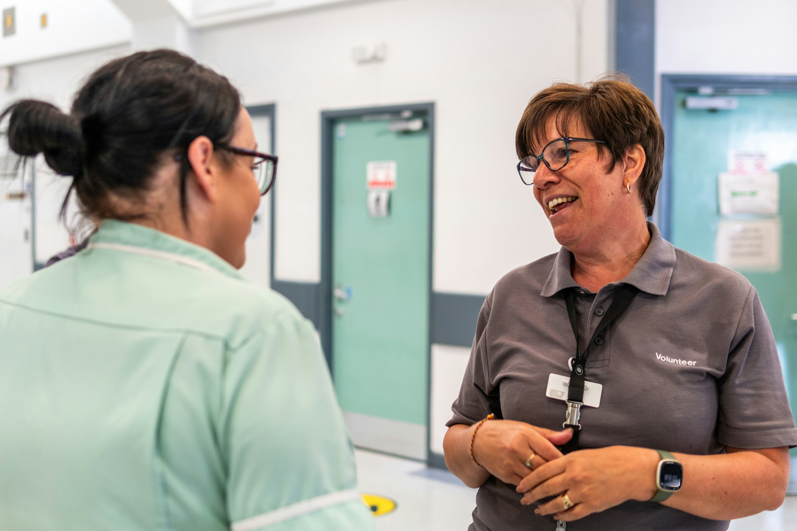

As a research volunteer, you support a study under supervision, within a defined non-clinical scope. This page covers what you can and cannot do, eligibility, the agreements you'll sign, your confidentiality obligations, and the training that applies if tasks are delegated to you.

<CardGroup cols={3}>
  <Card title="Training, if delegated" icon="shield-check" href="/training/compliance-requirements">
    What you need before you start any task that's delegated to you.
  </Card>
  <Card title="Clinical Research 101" icon="lightbulb" href="/kb/foundations/clinical-research-101">
    What research is, the study types, and who does what on a team.
  </Card>
  <Card title="Glossary" icon="book" href="/kb/foundations/glossary">
    Plain-language definitions for the terms you'll hear.
  </Card>
</CardGroup>

<Note>
  You'll sign a Confidentiality Agreement before you begin, and your scope is limited to non-clinical, supervised tasks. If any task is delegated to you, you must complete the required training first.
</Note>

## What you can and cannot do

Volunteers contribute valuable support to research teams — but there are strict institutional rules about what tasks a volunteer may perform. These exist to protect patients and to protect you.

<Warning>
  **Volunteers may not approach research participants, access identifiable patient health records (including OACIS), or be listed on research protocols.** Violations of these restrictions are reportable events with serious consequences for the study and the supervising <Tooltip tip="The investigator who leads the study team at a site and is responsible for conducting the study there." headline="Principal Investigator (PI)" cta="Full definition" href="/kb/foundations/glossary#pi">PI</Tooltip>. If you are ever asked to do something you are unsure about, ask your supervisor before proceeding.
</Warning>

**You can:**

- Administrative tasks — filing, photocopying, organizing study binders, scheduling, data entry from de-identified sources
- Non-participant-facing study support — preparing materials, entering coded data, supporting logistics
- Tasks delegated to you on the <Tooltip tip="The investigator's list of the appropriately qualified people to whom the investigator has delegated significant study-related tasks." headline="Task Delegation Log (TDL)" cta="Full definition" href="/kb/foundations/glossary#tdl">Task Delegation Log</Tooltip> — within the limits above, and only after your PI has countersigned your entry

**You cannot:**

- Contact, recruit, or perform procedures on research participants
- Access identifiable patient health records (OACIS, medical charts, any system containing patient names, MRNs, or dates of birth)
- Be listed on research protocols
- Perform any act reserved to a licensed professional (blood draws, medication administration, medical assessments)

## Eligibility

To volunteer at the RI-MUHC, you must:

- Be eligible to work in Canada (Canadian citizen, permanent resident, or valid work or study permit)
- Hold at minimum a high school leaving certificate

<Note>
  If you are a student enrolled in a Canadian university program and the work relates to your thesis or academic research, you may qualify as a **research trainee** instead of a volunteer — trainees have a broader task scope. See [Trainee](/roles/trainee).
</Note>

## Getting started

Volunteer onboarding is handled through People and Culture's [HR Service Centre](mailto:ri.hr.centre@muhc.mcgill.ca). Complete all steps before beginning any work.

<Steps>
  <Step title="Supervisor's Authorization form">
    Signed by the PI who will supervise your placement. This form confirms the PI takes responsibility for your activities and training.
  </Step>
  <Step title="Confidentiality and Security Agreement">
    You must sign this before accessing any RI-MUHC systems or being present in areas where patient information may be visible. See the confidentiality section below.
  </Step>
  <Step title="Proof of eligibility to work in Canada">
    Provide documentation of Canadian citizenship, permanent residency, or valid work/study permit.
  </Step>
  <Step title="Task Delegation Log">
    Your PI adds you to the study's TDL with your specific delegated tasks (within the permitted scope) and countersigns to confirm your qualification. You sign to accept. No study tasks before this is complete.
  </Step>
</Steps>

Contact People and Culture's [HR Service Centre](mailto:ri.hr.centre@muhc.mcgill.ca) or your supervising PI for the full volunteer onboarding checklist and downloadable forms.

## Confidentiality and privacy

Research at the RI-MUHC involves sensitive personal health information protected by Quebec law. Your confidentiality obligations are the same as those of any team member — a breach has the same consequences regardless of your employment status.

- The MUHC Confidentiality and Security Agreement ([SOP-CR-019](/sops/cr-019), Appendix 1) must be signed before you begin. This is an institutional requirement separate from any study-specific confidentiality agreement.
- Never discuss participant information outside the research team — participant names, medical details, study participation status, and any information you may see in the research environment.
- Do not photograph, screenshot, or copy any documents containing patient or participant information.
- If you handle coded study data, the coding key is never accessible to you. You work with study numbers only.
- These obligations continue after your volunteer placement ends.

See [Privacy and Confidentiality in Research](/kb/governance/privacy) and [Storing and Sharing Human Data](/kb/conduct/data-documentation/data-security) for the full regulatory framework.

## Professional order members

Membership in a Quebec professional order does not let a volunteer contact or recruit research participants, or perform procedures on them. [The RI-MUHC's standard operating procedures (SOPs)](/sops/cr-003#scope) bar volunteers and other people who are not affiliated with the RI-MUHC or the MUHC from these tasks, because they are not covered by professional or academic liability insurance. The SOPs make no exception for members of a professional order, such as the Ordre des infirmières et infirmiers du Québec or the Collège des médecins du Québec.

{/* Sources: SOP-CR-003_10, section 2.0, its Note, and QA's draft SOP-CR-003_11, section 2.0, its Note (the same text): "Non-affiliated RI-MUHC/MUHC members (including volunteers) are not allowed to contact, recruit and/or perform procedures on a research participant at the RI-MUHC/MUHC as they are not covered by professional or academic liability insurance." Changed (batch b163, second reader; the b163 fact check, A finding 1): this section said that a volunteer who is a member of a Quebec professional order and can give a membership number "may be eligible for an expanded task scope": access to identifiable patient health records with MUHC authorization through Nagano (and an EFVP when records are accessed without consent), approaching and interacting with participants, and being listed on protocols; then "Professional order membership establishes eligibility for this access. MUHC authorization through Nagano, with an EFVP when records are accessed without consent, is a separate requirement that applies regardless of who is accessing records. Confirm with your supervising PI and the Research Facilitator before taking on expanded tasks." No RI-MUHC SOP, in force or in QA's drafts, nor the Regulatory Framework or the REB's SOPs, makes the exception (searched "professional order", "OIIQ", "membership number" and "ordre professionnel" in tools/_sources_text/); FACTS "Volunteers and participants" recorded it as having no source. The EFVP's rule has its home on kb/governance/privacy. The page's other "Exception" line, under "What you can and cannot do", went with it. */}

## Training requirements

If you are added to the Task Delegation Log, you must complete the SOP Reader and Assessment at the level required for the study type — the same requirement as any other team member. There is no exemption for volunteers. Training must be documented on a valid [TalentLMS](/apps/talentlms) certificate before you begin any delegated tasks.

For the training matrix by study type, see [Training and Compliance Requirements](/training/compliance-requirements). For external certification instructions (GCP, Division 5), see [External Training Resources](/training/external-certifications). If your tasks involve data entry, see [Data Integrity](/kb/conduct/data-documentation/data-integrity) for ALCOA+ principles and Good Documentation Practice.

## During your volunteer placement

- You work under the direct supervision of the PI or their delegate (typically the <Tooltip tip="A nurse, health professional or other qualified member of the research team who handles most of the administrative responsibilities and day-to-day activities of a clinical trial." headline="Clinical Research Coordinator (CRC)" cta="Full definition" href="/kb/foundations/glossary#crc">CRC</Tooltip>). If you are uncertain about whether a task is within your scope, ask before doing it.
- If your tasks change during the placement, the Task Delegation Log must be updated and countersigned by the PI before you perform the new tasks.
- If you witness something that concerns you — a potential safety issue, a deviation from the protocol, or a confidentiality concern — report it to your supervising PI or the CRC immediately.
- If you enrol in a Canadian university program and the work relates to your thesis, speak with your PI about transitioning to research trainee status — trainees have a broader task scope.
- When your placement ends, your PI records your end date on the Task Delegation Log.

For questions about clinical research processes at the RI-MUHC, contact the Research Facilitator at **research.facilitator@muhc.mcgill.ca**.

---

## Related resources

- [Clinical Research 101](/kb/foundations/clinical-research-101) — foundations of clinical research, study types, trial phases, and how it all works at the RI-MUHC
- [Training and Compliance Requirements](/training/compliance-requirements) — the full training matrix by study level
- [External Training Resources](/training/external-certifications) — GCP and other certification instructions
- [CANTRAIN](/training/cantrain) — free national clinical trials training
- [Building Your Research Team](/kb/team/building-your-team) — the Task Delegation Log and delegation framework
- [Privacy and Confidentiality in Research](/kb/governance/privacy) — the full privacy and confidentiality framework
- [Glossary](/kb/foundations/glossary) — terms, acronyms, and definitions used across the Hub
- [Trainee](/roles/trainee) — if you are enrolled in a university program
